<div align="center">


# S-Aloha

La plateforme ITIL qui se branche sur votre Active Directory<br/>
et montre à chacun **ce qui requiert son intervention, maintenant**.

**10 pratiques ITIL 4** reliées entre elles · **plus de 250 règles de gestion** · **NIS 2** intégré · **on-prem** et libre

[](https://github.com/christian-raj/S-Aloha/releases)
[](https://github.com/christian-raj/S-Aloha/actions/workflows/ci.yml)


[](LICENSE)

[Fonctionnalités](#fonctionnalités) · [Aperçu](#aperçu) · [Essayer](#essayer-en-5-minutes) · [Feuille de route](#feuille-de-route) · [Contribuer](#contribuer-et-soutenir) · [English](#english)

<br/>

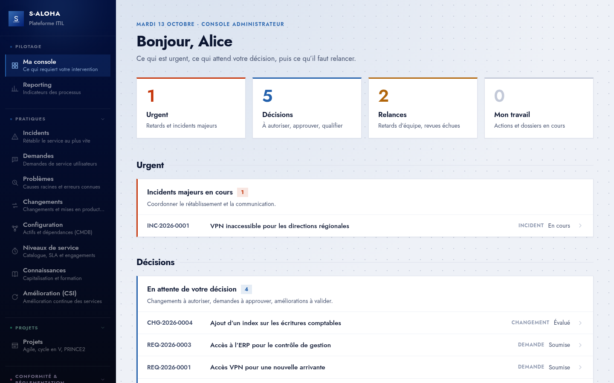

</div>

---

## Pourquoi S-Aloha

**🔐 Branché sur votre annuaire, dès le premier jour**
Vos utilisateurs se connectent avec leur compte Windows. Les droits suivent vos groupes
Active Directory : aucun compte à créer, aucun mot de passe stocké. Décisions et visibilité
se limitent au **périmètre** de chacun : direction, site ou entité.

**🎯 Une console qui dit quoi faire**
Chacun arrive sur ce qui l'attend, classé par criticité : incidents majeurs, SLA en risque,
changements à autoriser, demandes à approuver, actions en retard, revues échues. Une
**cloche** prévient des affectations, des décisions et des échéances.

**🔗 Des pratiques qui se parlent**
Un incident ouvre un problème, un problème appelle un changement, un changement touche des
CI et des services, une erreur connue devient un article, un SLA sous la cible propose une
amélioration. Tout se relie par référence, sur un socle commun.

**🧾 Un cycle de vie tenu, une trace de tout**
Chaque pratique suit son cycle de vie ITIL, avec ses garde-fous : un changement s'évalue
avant d'être autorisé, une demande s'approuve avant d'être traitée, un incident se résout
avec un code. Chaque fiche garde ses **commentaires** et son **historique** complet.

**🔎 La bonne solution avant le ticket**
Recherche **hybride** (mots et sens) dans la connaissance, les problèmes et les incidents
résolus : « Chercher d'abord » avant d'ouvrir un ticket, « Cas similaires » sur chaque
fiche. Le modèle tourne chez vous ; sans lui, la recherche reste plein texte.

**🏠 Chez vous, en une commande, et libre**
On-prem, quatre containers (dont la recherche sémantique, facultative) : vos données restent
dans votre SI. Logiciel libre sous AGPLv3 : pas de licence par utilisateur, pas de
dépendance à un éditeur.

## Pour qui

- Les **DSI d'organisations sous Active Directory** — PME, ETI, collectivités,
  établissements publics — qui veulent des pratiques ITIL 4 sans outil propriétaire.
- Les **entités soumises à NIS 2**, qui évaluent leur conformité et suivent leurs écarts au
  même endroit que leurs incidents et leurs changements.
- Les **équipes support et exploitation**, les **gestionnaires de processus** et les
  **chefs de projet** de la DSI : un rôle applicatif chacun, tiré des groupes AD.

## Fonctionnalités

### 🛟 Support aux utilisateurs

- **[Incidents](docs/reference/processus/gestion-des-incidents.md)** — priorité P1–P4 par
  impact × urgence, incident majeur piloté par un gestionnaire, échéances de prise en charge
  et de résolution en heures de service, SLA en risque signalé, mise en attente motivée,
  réouverture encadrée, problème lié en un clic.
- **[Demandes](docs/reference/processus/gestion-des-demandes.md)** — catalogue de demandes
  et modèles pré-approuvés, bénéficiaire, approbation, échéance et groupe d'exécution,
  demandes en retard en relance, annulation par le demandeur.
- **[Connaissances](docs/reference/processus/gestion-des-connaissances.md)** — articles en
  Markdown, soumission puis publication validée, revue périodique, articles d'erreur connue
  créés depuis les problèmes, compteur d'utilisation.

### 🔧 Maîtrise du SI

- **[Problèmes](docs/reference/processus/gestion-des-problemes.md)** — trois analyses de
  cause racine intégrées (**5 Pourquoi**, **Ishikawa 6M**, **arbre des défaillances**),
  erreurs connues et contournements, actions correctives avec échéance et matrice **RACI**
  sur des personnes ou des groupes AD, gestionnaire du problème, problèmes récurrents détectés.
- **[Changements](docs/reference/processus/habilitation-des-changements.md)** — Standard,
  Normal, Urgent ; modèles standard pré-autorisés, autorité selon le risque et **CAB**,
  séparation des tâches, périodes de **gel**, plans de mise en œuvre et de retour arrière,
  calendrier et conflits, revue post-implémentation.
- **[Configuration (CMDB)](docs/reference/processus/gestion-de-la-configuration.md)** —
  éléments de configuration par type et environnement, relations et **impact** en amont et
  en aval, rattachement aux services, vérification périodique, retrait encadré ;
  **portefeuille applicatif** et **actifs matériels** avec inventaire et fins de support ;
  **découverte automatique** (balayage IP et bannières, SNMP v2c et v3, Active Directory,
  inventaire SSH des serveurs Linux et WinRM des serveurs Windows, hyperviseurs Proxmox VE et
  vCenter) avec sas de staging, rapprochement des CI, détection du Shadow IT, coffre
  d'identifiants chiffré, et relations « Héberge » et « Se connecte à » proposées au
  gestionnaire.

### 📈 Qualité de service et pilotage

- **[Niveaux de service](docs/reference/processus/gestion-des-niveaux-de-service.md)** —
  catalogue des services, SLA en heures de service (délais de prise en charge et de
  résolution P1–P4), **respect mesuré** et alerte sous la cible, expiration et revues.
- **[Amélioration continue](docs/reference/processus/amelioration-continue.md)** — registre
  priorisé, modèle ITIL 4 en 7 étapes, mesures de départ et cible, propositions automatiques
  sur problèmes récurrents et SLA sous la cible.
- **[Reporting](docs/reference/reporting.md)** — **score de santé** des services, MTTR, MTTD,
  résolution au premier contact, respect des SLA, problèmes, changements, projets,
  conformité ; filtres par période, service et périmètre, exports CSV et PDF.
- **[Projets](docs/reference/processus/gestion-de-projet.md)** — Scrum, Kanban, Cycle en V,
  PRINCE2 ou hybride : la méthode active backlog, sprints et burndown, tableau, phases,
  jalons, livrables, risques, tolérances, prévision de la date de fin.

### 🛡️ Sécurité et conformité

- **[Conformité NIS 2](docs/reference/processus/conformite-nis2.md)** — évaluation au
  Référentiel Cyber France de l'ANSSI : questionnaire noté, scores et maturité, écarts reliés
  à des actions d'amélioration, preuves liées aux enregistrements, comparaison entre deux
  évaluations, export CSV pour l'auditeur, revue annuelle.
- **[Déclarations réglementaires](docs/reference/processus/declarations-reglementaires.md)** —
  un incident de sécurité qualifié par un gestionnaire ouvre ses déclarations NIS 2 (ANSSI :
  alerte précoce 24 h, notification 72 h, rapport final) et RGPD (CNIL : 72 h) ; échéances
  légales calculées et rappelées, contenu figé à chaque envoi, respect des délais au reporting.
- **[Périmètres](docs/reference/perimetres.md)** — droits et visibilité par direction, site
  ou entité ; utilisateurs et groupes AD affectés depuis l'écran d'administration.
- **Traçabilité** — journal d'audit sur chaque fiche : qui a changé quoi, quand, avec
  l'ancienne et la nouvelle valeur ; transitions forcées motivées.
- **[Administration](docs/reference/administration.md)** — utilisateurs et rôles lus dans
  l'annuaire avec leur dernière connexion, santé de la plateforme, journal d'audit global
  et export, nettoyage des doublons ; catégories d'incident et de problème tenues par les
  gestionnaires.

## Aperçu

<table>
  <tr>
    <td width="50%">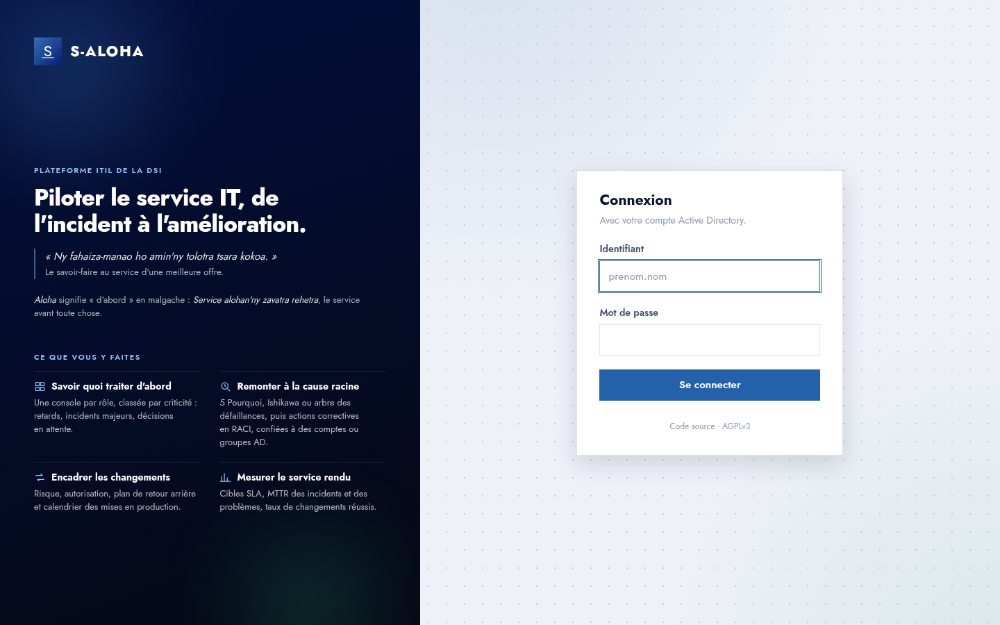<br/><b>Connexion</b> — avec le compte Active Directory</td>
    <td width="50%">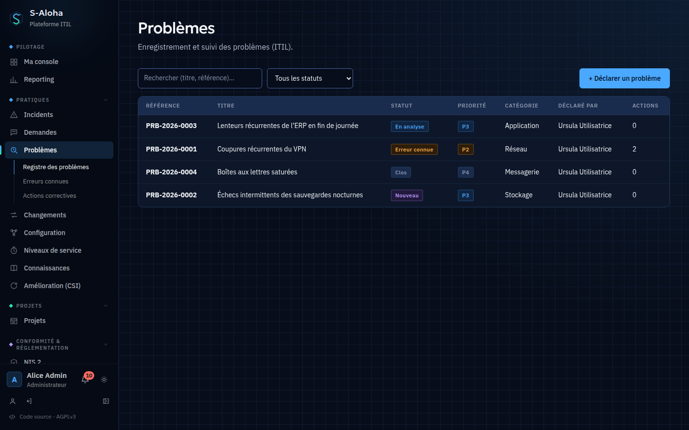<br/><b>Registre des problèmes</b> — statut, priorité P1–P4 calculée</td>
  </tr>
  <tr>
    <td>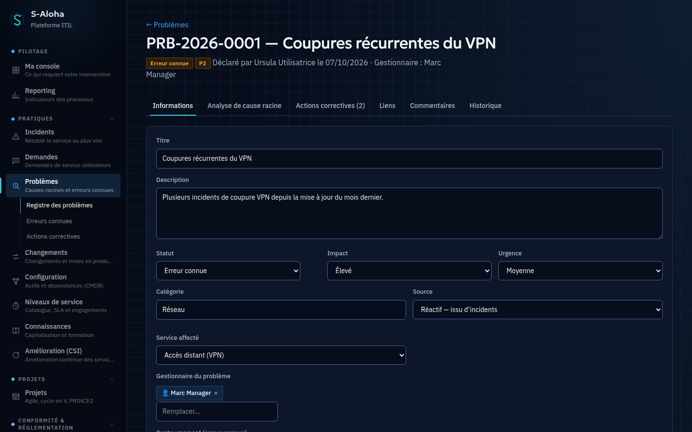<br/><b>Fiche problème</b> — impact × urgence, contournement, cause racine</td>
    <td>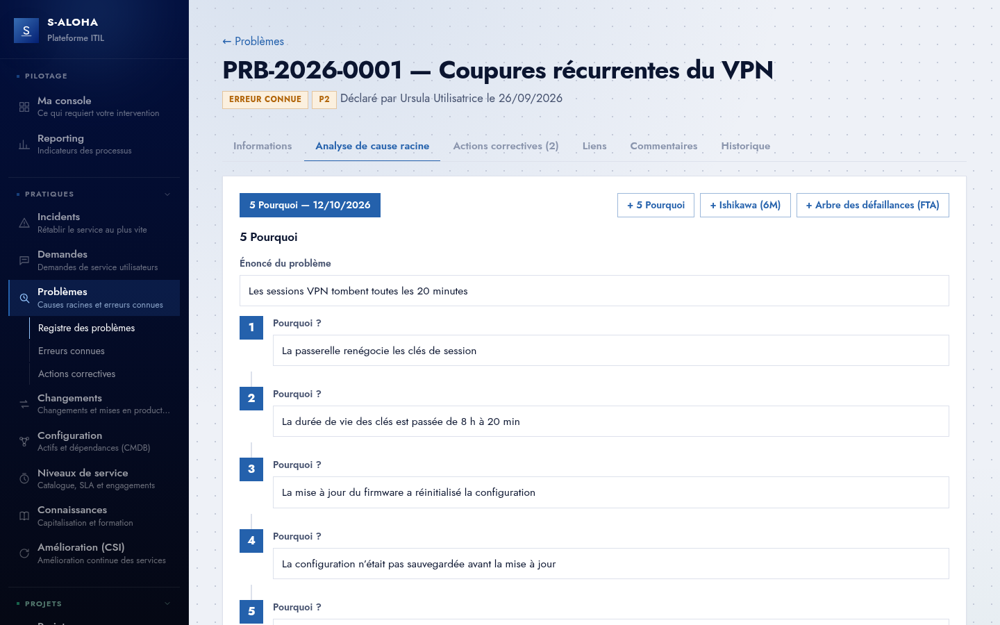<br/><b>Analyse de cause racine</b> — 5 Pourquoi, Ishikawa, FTA</td>
  </tr>
  <tr>
    <td>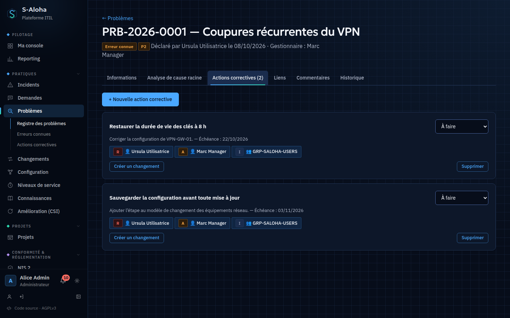<br/><b>Actions correctives</b> — échéance et matrice RACI</td>
    <td>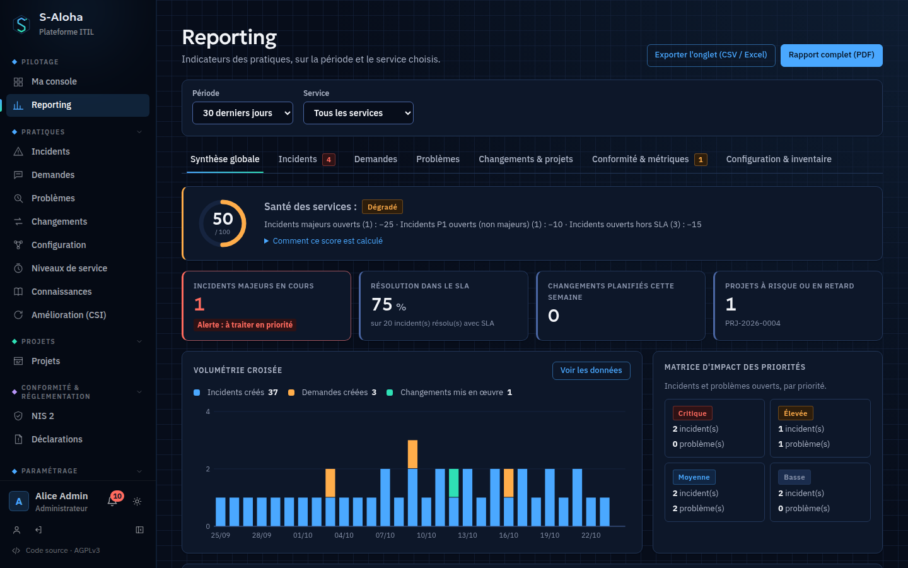<br/><b>Reporting</b> — tableau de bord à onglets : santé, incidents, problèmes, changements et projets, conformité</td>
  </tr>
  <tr>
    <td>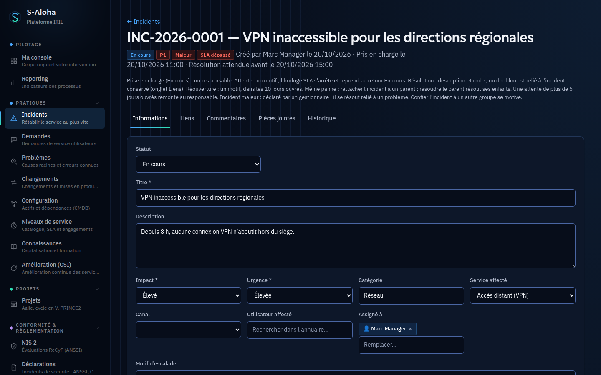<br/><b>Incident majeur</b> — priorité P1–P4, état du SLA, échéance de résolution</td>
    <td>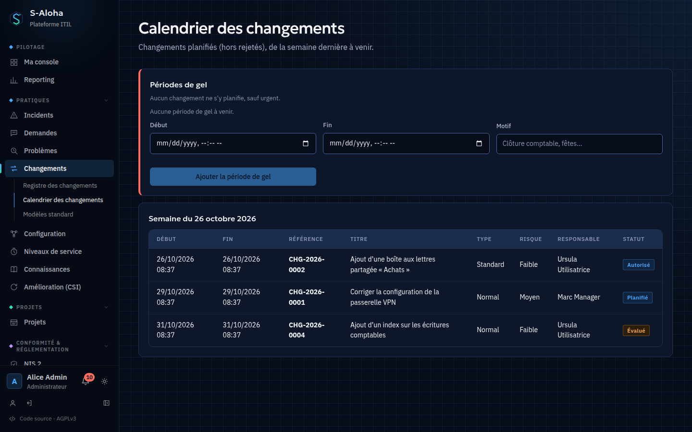<br/><b>Changements</b> — autorisation et calendrier des mises en production</td>
  </tr>
  <tr>
    <td>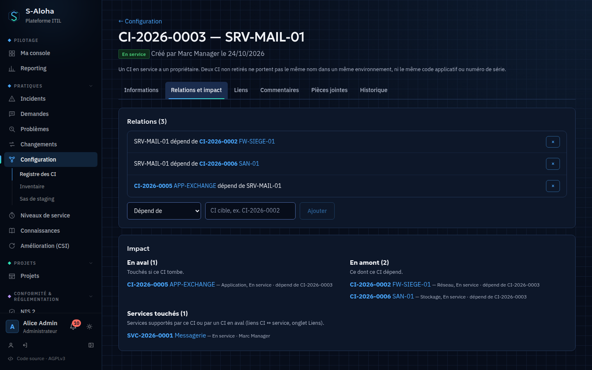<br/><b>Configuration</b> — éléments de configuration et leurs dépendances</td>
    <td>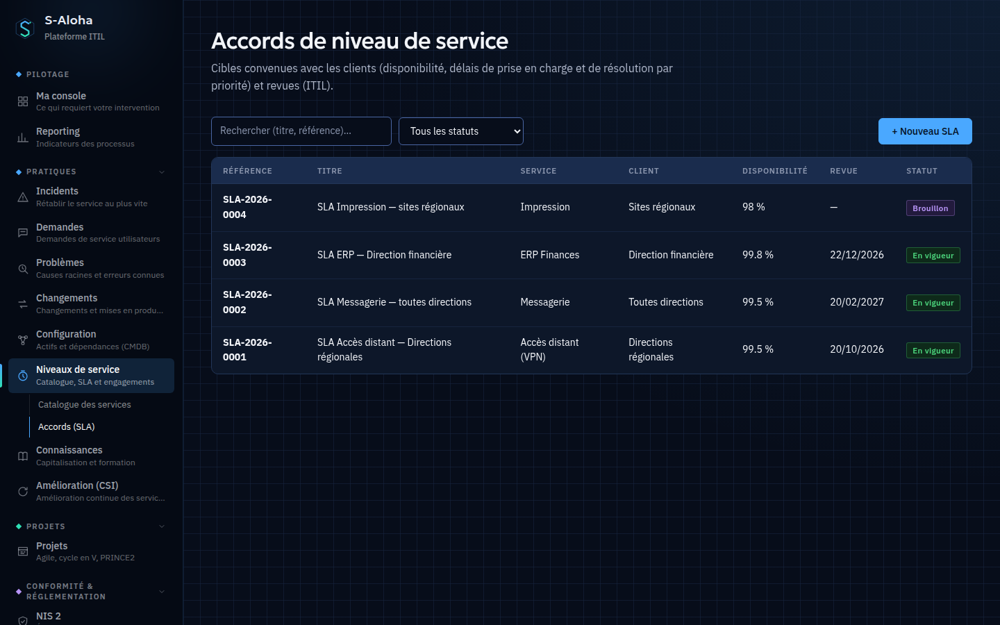<br/><b>Niveaux de service</b> — SLA par service, disponibilité, revues</td>
  </tr>
  <tr>
    <td>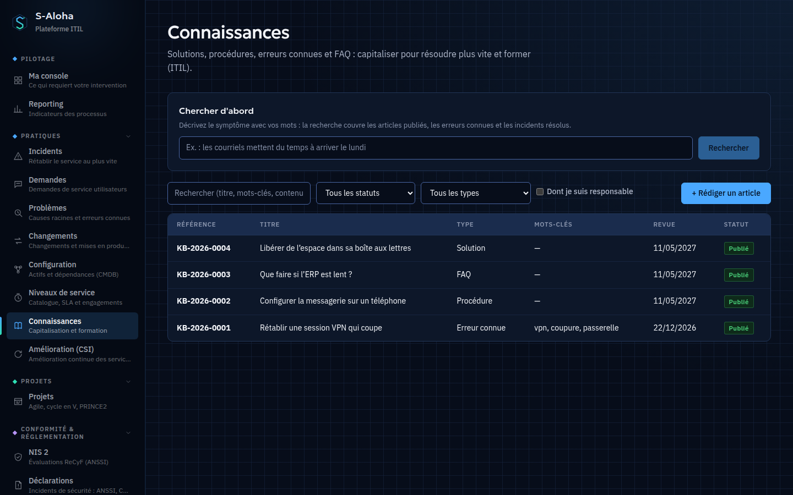<br/><b>Connaissances</b> — solutions, procédures, erreurs connues</td>
    <td>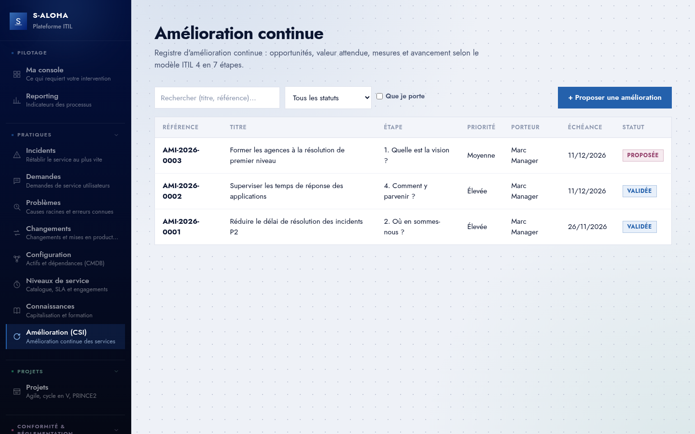<br/><b>Amélioration continue</b> — registre et modèle ITIL 4 en 7 étapes</td>
  </tr>
  <tr>
    <td>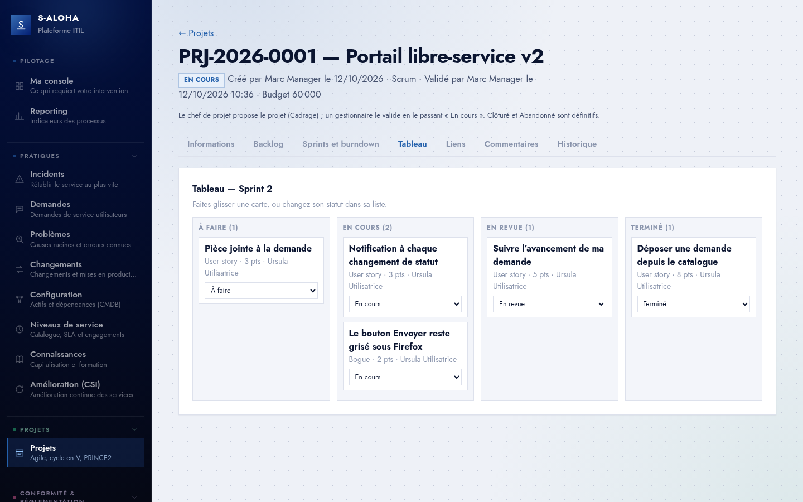<br/><b>Projets</b> — Scrum, cycle en V, PRINCE2 : backlog, sprints, tableau</td>
    <td>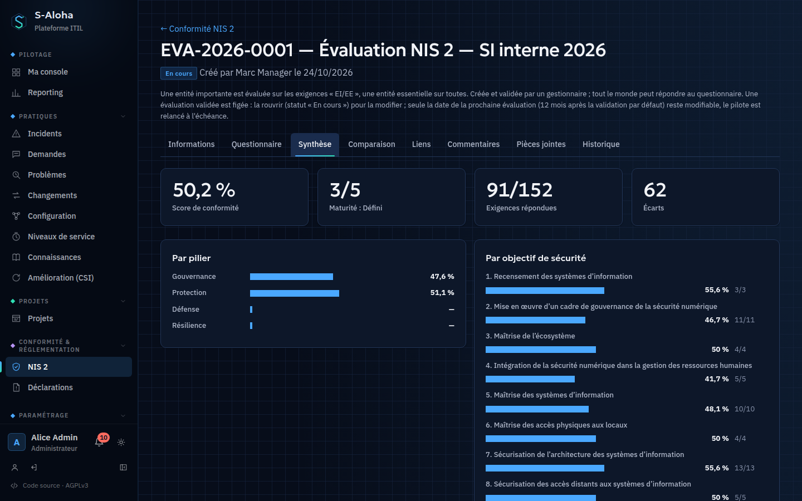<br/><b>Conformité NIS 2</b> — évaluation, score, maturité et écarts par objectif</td>
  </tr>
  <tr>
    <td>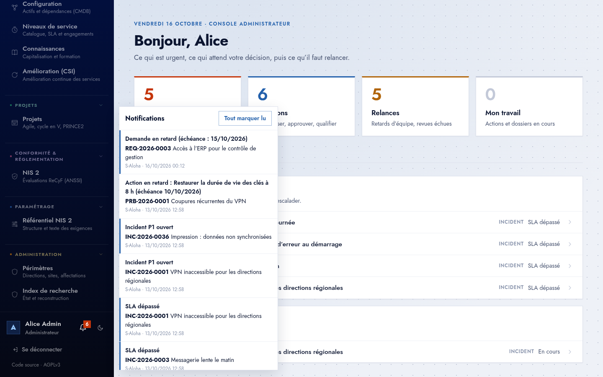<br/><b>Notifications</b> — demandes en retard, actions en retard, SLA dépassés, incidents P1</td>
    <td>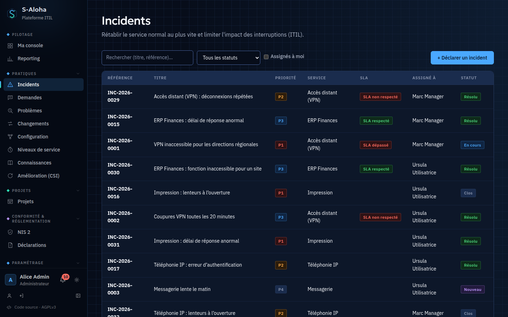<br/><b>Registre des incidents</b> — priorité, service, état du SLA</td>
  </tr>
</table>

## Essayer en 5 minutes

Pas besoin d'Active Directory : le **mode démonstration** démarre son propre annuaire et
charge des données d'exemple fictives. Seul Docker est requis.

```bash
git clone https://github.com/christian-raj/S-Aloha.git && cd S-Aloha
docker compose -f docker-compose.yml -f docker-compose.demo.yml up -d
```

Les images publiées de la dernière version sont téléchargées ; ajoutez `--build` pour
construire depuis les sources.

Ouvrez **http://localhost** et connectez-vous avec l'un des comptes de démonstration :

| Compte | Mot de passe | Rôle |
|---|---|---|
| `demo.admin` | `Demo-Admin-2026` | Administrateur |
| `demo.manager` | `Demo-Manager-2026` | Gestionnaire |
| `demo.user` | `Demo-User-2026` | Utilisateur |

**Avec votre Active Directory** : renseignez-le dans `docker-compose.yml` (variables
`Ldap__*` du service `api`), puis `docker compose up -d --build`. Les utilisateurs doivent
appartenir à l'un des groupes `GRP-SALOHA-ADMINS`, `GRP-SALOHA-MANAGERS` ou
`GRP-SALOHA-USERS` (noms configurables). Détails : [guide d'exploitation](docs/reference/exploitation.md).

> [!IMPORTANT]
> Mode démonstration et configuration fournie servent à l'évaluation : mots de passe
> publics, ni LDAPS ni HTTPS. Avant une mise en production, suivez
> [la liste de durcissement](docs/reference/securite.md#points-de-durcissement-avant-production).

## Feuille de route

La plupart des évolutions sont déjà **spécifiées règle par règle**, avec leurs scénarios
d'acceptation ([pratiques ITIL](docs/reference/processus/readme.md)). Les prochains chantiers :

- 📎 **Pièces jointes** sur chaque fiche, et **notifications par courriel** (immédiates ou
  en résumé quotidien).
- 📋 **Référentiels de conformité importés** par l'organisation (ISO 27002, CR-CMM…), à côté
  de NIS 2.
- 🗃️ **Import en masse** de la CMDB, attributs par type de CI, service signalé « dégradé ».
- 🙋 **Tâches d'exécution** des demandes, contestation, **enquête de satisfaction**.
- 🔎 **Suggestions à la saisie** : les cas similaires dès le titre d'un incident.

Le détail et l'ordre : [plan d'action](docs/plan-action.md#7-feuille-de-route-fonctionnelle).
Une organisation peut **sponsoriser** un chantier pour l'accélérer : le résultat est publié
pour tous ([Soutenir S-Aloha](docs/soutenir.md)).

## Sous le capot

| | |
|---|---|
| **Frontend** | React 19 + Vite, CSS natif à jetons, servi par nginx |
| **API** | ASP.NET Core 10 (LTS) + Entity Framework Core, Swagger sur `/swagger` |
| **Données** | PostgreSQL 16 ; migrations EF appliquées au démarrage |
| **Recherche** | Plein texte PostgreSQL + embeddings `bge-m3` dans un service séparé, facultatif |
| **Identité** | Active Directory (LDAP) → JWT, rôles Admin / Manager / User |
| **Tests** | xUnit + Testcontainers (API), Vitest + Testing Library (frontend) |

Socle commun dans `backend/Core` et `frontend/src/core`, un module par processus dans
`Modules/` et `modules/`. Détail : [architecture](docs/reference/architecture.md).

```bash
TESTCONTAINERS_RYUK_DISABLED=true dotnet test tests/SAloha.Api.Tests   # API, Docker requis
cd frontend && npm test                                                # interface
```

## Contribuer et soutenir

S-Aloha est un projet ouvert : code, documentation, retours d'usage, tout compte.

- 📐 **Une spécification prête à coder.** Chaque pratique a son document : rôles, données,
  cycle de vie, règles numérotées, scénarios d'acceptation. Une soixantaine de règles 🔜
  attendent leur implémentation ; chacune est une pull request bien délimitée, citée par son
  identifiant (`INC-15`, `REQ-24`…). Commencer par le
  [mode d'emploi](docs/reference/processus/readme.md#mode-demploi-pour-implémenter-une-règle).
- 🧩 **Première contribution ?** Les issues
  [`good first issue`](https://github.com/christian-raj/S-Aloha/issues?q=is%3Aissue+is%3Aopen+label%3A%22good+first+issue%22)
  sont prêtes à prendre : contexte, fichiers concernés, critère de fin. Plus large :
  [`help wanted`](https://github.com/christian-raj/S-Aloha/issues?q=is%3Aissue+is%3Aopen+label%3A%22help+wanted%22).
- 🧪 **Un terrain sûr.** Le mode démonstration démarre sans Active Directory ; tests d'API
  sur une vraie base PostgreSQL (Testcontainers), tests d'interface, CI à chaque pull request.
- 📝 Le [guide de contribution](CONTRIBUTING.md) explique comment proposer une
  modification. Chaque commit est signé (`git commit -s`, *Developer Certificate of Origin*).
- 💛 **Votre organisation utilise S-Aloha ?** Le soutien financier fait avancer la feuille
  de route plus vite : voir [Soutenir S-Aloha](docs/soutenir.md).

## Documentation

| | |
|---|---|
| 🧭 [Produit](docs/reference/produit.md) | Vision, publics, pratiques couvertes |
| 📐 [Règles métier](docs/reference/regles-metier.md) | Rôles, console, cycle de vie et transitions, priorité, historique |
| 🗂️ [Pratiques ITIL](docs/reference/processus/readme.md) | Une spécification par pratique : règles numérotées ✅ / 🔜, scénarios d'acceptation |
| 🏗️ [Architecture](docs/reference/architecture.md) | Containers, socle et modules, API, tests |
| ⚙️ [Exploitation](docs/reference/exploitation.md) | Installation, Active Directory, mise à jour |
| 🛡️ [Sécurité](docs/reference/securite.md) | Modèle d'autorisation, durcissement |
| 🔎 [Recherche](docs/reference/recherche.md) | Recherche hybride, cas similaires, service d'embeddings |
| 📊 [Reporting](docs/reference/reporting.md) | Tableau de bord : score de santé, indicateurs par onglet, filtres, exports |
| 🧭 [Périmètres](docs/reference/perimetres.md) | Droits scopés par direction, site ou entité (droits, visibilité, écran d'administration) |
| 📦 [Journal des versions](CHANGELOG.md) | Nouveautés et consignes de mise à jour de chaque version |
| 🤝 [Contribuer](CONTRIBUTING.md) | Issues, pull requests, contrôles avant envoi |
| 🚨 [Signaler une faille](SECURITY.md) | En privé, jamais dans une issue publique |
| 📚 [Tout le reste](docs/readme.md) | Base de données, frontend, décisions, plan d'action |

## English

**S-Aloha** is a free (AGPLv3), self-hosted **ITIL 4 service-management platform** for
IT departments that run **Active Directory**. Users sign in with their Windows account;
roles follow AD groups. Each user lands on an action-oriented console showing what needs
their attention, ranked by severity. **10 linked ITIL 4 practices, 250+ business rules in
place, NIS 2 built in.**

- **User support**: incidents (P1–P4, major incidents, response and resolution targets in
  service hours, SLA-at-risk warnings), service requests (catalogue, pre-approved
  templates, approval, fulfilment group), knowledge base (Markdown, review cycle,
  known-error articles).
- **Control of the IT estate**: problem management with root-cause analysis (5 Whys,
  Ishikawa, fault tree) and RACI corrective actions; change enablement (standard models,
  risk-based authority and CAB, freeze periods, schedule, post-implementation review);
  CMDB with relationships, impact analysis and service mapping, application portfolio and
  hardware assets, network discovery (IP sweep and banners, SNMP v2c/v3, Active Directory,
  SSH and WinRM inventory, Proxmox VE and vCenter hypervisors) through a staging area with
  CI reconciliation, shadow-IT detection, and hosting and network-flow relationships
  proposed for approval.
- **Service quality and steering**: service catalogue and SLAs with measured compliance,
  continual improvement (ITIL 7-step model, automatic proposals), a reporting dashboard
  (health score, MTTR/MTTD, FCR, SLA, CSV/PDF exports) and project management (Scrum,
  Kanban, V-model, PRINCE2 or hybrid).
- **Security and compliance**: **NIS 2** self-assessment against the French ANSSI
  framework (scores, gaps, evidence, comparison, auditor export), regulatory notifications of
  security incidents (NIS 2 early warning, notification and final report; GDPR 72 h) with legal
  deadlines and reminders, perimeter-scoped
  permissions (department, site, entity), full audit trail; an administration console
  (users and roles from the directory, platform health, global audit log, duplicate
  clean-up) and manager-maintained incident and problem categories.
- **On every record**: comments (public or work notes), history, in-app notifications,
  links between records, hybrid search (keywords + semantic, local `bge-m3` model).
- **Roadmap**: regulatory incident notifications (NIS 2, GDPR), attachments, e-mail
  notifications, imported compliance frameworks, CMDB bulk import.
- **Stack**: ASP.NET Core 10 (LTS), EF Core, PostgreSQL 16, React 19 + Vite, Docker Compose.
- **Try it**: `docker compose -f docker-compose.yml -f docker-compose.demo.yml up -d`,
  then sign in at http://localhost as `demo.admin` / `Demo-Admin-2026` (a demo directory
  is started for you).
- **Contribute**: every practice is specified rule by rule, with acceptance scenarios;
  about sixty specified rules are waiting for an implementation, each a well-scoped pull
  request. Documentation is in French, code in English; issues and pull requests are
  welcome in **English or French**. Start with a
  [`good first issue`](https://github.com/christian-raj/S-Aloha/issues?q=is%3Aissue+is%3Aopen+label%3A%22good+first+issue%22)
  and read [CONTRIBUTING.md](CONTRIBUTING.md). Commits are signed off (DCO).

## Licence

S-Aloha est un logiciel libre, distribué sous
[GNU Affero General Public License v3](LICENSE) ou toute version ultérieure.

Vous pouvez l'utiliser, le modifier et le redistribuer librement. Si vous mettez une
**version modifiée** à disposition d'utilisateurs à travers le réseau, vous devez leur
donner accès à son code source : l'interface affiche pour cela un lien « Code source »,
configurable ([détails](docs/reference/exploitation.md#licence-et-code-source)).

Copyright © 2026 Christian Rajaonary.

<div align="center">
<br/>
<sub><i>Service alohan'ny zavatra rehetra</i> — le service avant toute chose.</sub>
</div>
