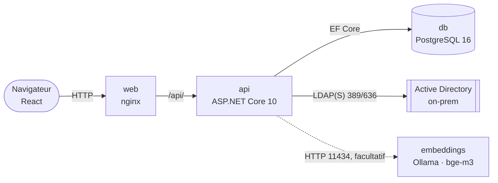
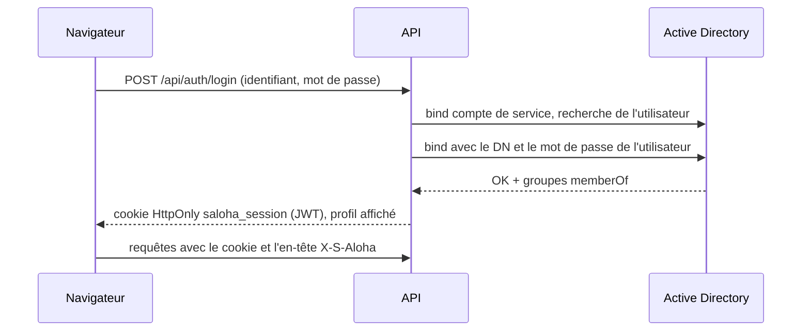

# 🏗️ Architecture

> Comment S-Aloha est construit : containers, socle et modules, authentification, API.

<sub>[← Documentation](../readme.md) · [Produit](produit.md) · [Règles métier](regles-metier.md) · [Architecture](architecture.md) · [Base de données](base-de-donnees.md) · [Frontend](frontend.md) · [Exploitation](exploitation.md) · [Sécurité](securite.md) · [Glossaire](glossaire.md)</sub>

## 1. Vue d'ensemble



Quatre containers orchestrés par `docker-compose.yml` : **web** (nginx sert le build React et proxifie `/api/` vers l'API), **api** (ASP.NET Core 8), **db** (PostgreSQL 16, volume persistant `pgdata`) et **embeddings** (Ollama, modèle `bge-m3`, réseau interne seulement), facultatif : sans lui, la recherche reste lexicale ([recherche](recherche.md), [ADR-0013](../decisions/adr-0013-recherche-hybride-service-embeddings-separe.md)).

## 2. Stack

| Couche | Choix | Notes |
|---|---|---|
| Frontend | React 19 + Vite 8, react-router 7 | Build statique servi par nginx ; aucune dépendance UI lourde (CSS natif à jetons, voir [frontend.md](frontend.md)) |
| Backend | ASP.NET Core 10 Web API (.NET 10 LTS) | Controllers REST, Swagger exposé sur `/swagger` (Swashbuckle 10, OpenAPI 3) |
| ORM | Entity Framework Core 10 (10.0.13) | Provider Npgsql ; schéma par migrations EF, appliquées au démarrage ([ADR-0008](../decisions/adr-0008-migrations-ef.md)) |
| Base | PostgreSQL 16 (provider Npgsql EF 10.0.3) | Remplaçable par SQL Server (provider EF + image du compose) |
| Annuaire | Novell.Directory.Ldap.NETStandard 4 (API asynchrone) | Bind de service pour la recherche, bind utilisateur pour l'authentification ; référents AD ignorés ; annuaire injoignable (serveur absent, compte de service refusé, délai `Ldap:TimeoutSeconds` dépassé) : 503 « Annuaire injoignable » à la connexion et à la recherche, jamais « identifiants invalides » (R6, R7) |
| Auth API | JWT Bearer (HS256, JwtBearer 10.0.13) | Claims : name, displayName, role, `adgroup` (un par groupe AD direct, SOC-10) ; expiration paramétrable |

Observabilité ([ADR-0017](../decisions/adr-0017-observabilite-journal-json-et-opentelemetry.md)) : journal JSON
hors développement, en-tête `traceparent` sur chaque réponse, traces et métriques
OpenTelemetry exportées en OTLP si un collecteur est configuré (`Core/Observability/Telemetry.cs`,
`ActivitySource` et `Meter` « SAloha »).

## 3. Organisation du code : socle et modules

S-Aloha est une **plateforme modulaire** : un **socle** (*Core*) transverse à tous les processus ITIL, et un **module** par processus. Les dix modules du registre sont implémentés (huit pratiques ITIL, Projets, Conformité NIS 2), tous sur un socle commun d'enregistrement (`Record`, `RecordController` ; les problèmes y sont passés le 2026-10-12, leurs analyses et actions restent des contrôleurs propres) (voir [produit.md](produit.md) et [ADR-0007](../decisions/adr-0007-pratiques-itil4-et-socle-commun-des-processus.md)).

```
backend/                              # projet SAloha.Api (namespace SAloha.Api.*)
├── Program.cs                        # DI, JWT, policies, CORS, migrations au démarrage
├── Core/                             # socle — ne dépend d'aucun module
│   ├── Audit/                        # AuditEntry, AuditInterceptor (journal SOC-20), AuditController, ForcedTransition
│   ├── Auth/                         # AuthController, LdapService (aussi IUserDirectory : rôle d'un autre compte, INC-13), TokenService, AuthDtos
│   ├── Data/                         # AppDbContext, References (XXX-AAAA-NNNN), DatabaseSchema + Migrations/
│   ├── Comments/                     # Comment, CommentsController (fil de commentaires, SOC-24)
│   ├── Directory/                    # DirectoryController, DirectoryEntry (recherche AD)
│   ├── Itil/                         # Priority (matrice impact × urgence → P1–P4)
│   ├── Links/                        # ItemLink, registre ItemLinks, LinksController (liens inter-processus)
│   ├── Notifications/                # Notification, NotificationRead, Notifier (émission), DatedEvents (événements datés), NotificationsController (SOC-21)
│   ├── Perimeters/                   # Perimeter, PerimeterAssignment, PerimeterAccess (rôle effectif), PerimetersController (ADR-0014)
│   ├── Pilotage/                     # ConsoleController, ReportsController, DashboardController (vues transverses)
│   └── Records/                      # Record (entité de base), RecordController<T,TDto>, Allowed, Dates
└── Modules/
    ├── ProblemManagement/            # Gestion des problèmes : Problems, Analyses, Actions
    ├── IncidentManagement/           # Gestion des incidents : Incidents
    ├── ServiceRequestManagement/     # Gestion des demandes de service : ServiceRequests
    ├── ChangeEnablement/             # Habilitation des changements : Changes (+ calendrier)
    ├── ServiceConfigurationManagement/ # Configuration des services : ConfigurationItems (+ relations), découverte (Discovery/ : collecteurs, sas de staging, coffre)
    ├── ServiceLevelManagement/       # Niveaux de service : Services, Agreements
    ├── KnowledgeManagement/          # Connaissances : Knowledge
    ├── ContinualImprovement/         # Amélioration continue : Improvements
    ├── ComplianceAssessment/         # Conformité NIS 2 : Assessments, référentiel
    └── ProjectManagement/            # Projets : Projects et ses composants (phases, sprints, éléments de travail…)
        # chaque module : Controllers/ et Models/ (Entities.cs : entités et DTO d'entrée ; Views.cs : DTO de réponse)
```

### Socle commun des processus (`Core/Records`)

Les processus autres que les problèmes héritent d'un même socle :

- **`Record`** — classe de base non mappée (une table par processus) : `Id`, `Reference`,
  `Title`, `Description`, `Status`, responsable AD (`OwnerType`, `OwnerId`,
  `OwnerDisplayName`), traçabilité (`CreatedBy`, `CreatedAt`, `UpdatedAt`).
- **`RecordController<T, TDto, TView>`** — API CRUD commune ; `TView` est la réponse (DTO, `View(e)`), jamais l'entité ([ADR-0016](../decisions/adr-0016-reponses-de-l-api-en-dto.md)) ; un convertisseur JSON (`Core/Data/EntityGuard.cs`) refuse toute entité EF dans une réponse ou une requête, et `OpenApiTests` fige les champs des vues (`tests/SAloha.Api.Tests/openapi-reponses.json`) : liste (`status`, `q`, `owner=me`),
  détail, création avec référence (`References.CreateAsync`), modification avec contrôle
  du statut, suppression (Admin, liens compris). Un module ne déclare que son préfixe,
  ses statuts et ses règles : `Transitions` (graphe des transitions permises, SOC-05,
  servi par `GET …/transitions` ; refus 400 « Transition de A vers B non permise » avec les
  statuts accessibles), `Apply` (champs et valeurs fermées), `RequiresManager`
  (statuts réservés — `IsManager` vaut sur le périmètre de l'enregistrement, PER-06), `CheckStatus` (conditions du statut, vérifiées à chaque
  enregistrement), `OnStatusChanged` (horodatages), `ConflictAsync` (doublon interdit,
  refus 409 : nom de CI unique par environnement), `StatusAfterEdit` (statut auquel
  la modification d'un non-gestionnaire ramène l'enregistrement), `RequiresManager(from, to)` (statut réservé selon le statut d'origine : réactiver un article archivé), `InitialStatus`, `ManagerOnly`
  (référentiels), `CanCreate` et `CanEdit` (droit de créer, de modifier un enregistrement
  d'après ses valeurs enregistrées : un projet se modifie par son chef de projet ; par défaut
  `ManagerOnly`), `OnNotify` (événements notifiés de la pratique, SOC-21 ; l'affectation au responsable est notifiée par le socle), `OnCreatedAsync` (objets dépendants créés après l'enregistrement : phases
  proposées d'un projet), `BeforeSaveAsync` (valeurs calculées qui interrogent la base, juste
  avant l'enregistrement : échéance SLA d'un incident, INC-21), `Filter`/`Search`/`WithDetails`, `ListItems` (colonnes du registre).
  Les longueurs `[MaxLength]` sont contrôlées avant l'enregistrement (`Lengths`).
- **`References.CreateAsync`** — référence annuelle `XXX-AAAA-NNNN` (plus grand numéro + 1,
  nouvelle tentative sur collision de l'index unique) ; utilisée aussi par les problèmes.

**Portée par périmètre** (`Core/Perimeters/PerimeterAccess`, [PER-03 à PER-07](perimetres.md)) :
rôle effectif de l'utilisateur sur chaque périmètre, chargé une fois par requête. Le socle
filtre les registres (`InScopeAsync`), répond 404 hors portée (`VisibleAsync`, aussi pour les
routes propres d'un module), évalue `IsManager` sur le périmètre de l'enregistrement
(`ActOn`) et contrôle le choix (`ChooseAsync`) et le changement (`CheckMoveAsync`) de
périmètre. `SharedWithAll` déclare un référentiel lisible de tous (catalogue des services,
articles publiés). Les vues transverses suivent la même portée (PER-08, PER-09) : liens
(`LinkTarget.PerimeterId`, `Shared`), recherche (filtre après classement), console (pilotage
limité aux périmètres gérés) et reporting (`Core/Pilotage/ReportScope`, paramètre `perimeter`).

Règles de dépendance :
- un **module** peut utiliser le socle (auth, annuaire, `AppDbContext`) ;
- le **socle** n'importe pas le code d'un module, à l'exception de `Core/Pilotage`, `Core/Data` et `Core/Links` qui agrègent les données des modules (console, reporting, `DbSet`, registre des types reliables) ;
- un module n'appelle pas un autre module directement : les liens entre processus passent par `Core/Links` (table `ItemLinks`).

Ajouter un module : créer `Modules/<Processus>/{Controllers,Models}` — entité dérivée de `Record`, DTO implémentant `IRecordDto`, contrôleur dérivé de `RecordController` —, déclarer ses `DbSet` et l'index unique de sa référence dans `AppDbContext`, l'inscrire dans `ItemLinks.Kinds` s'il est reliable, puis son interface côté frontend (voir [frontend.md](frontend.md) § Ajouter un module).

## 4. Authentification et autorisation



1. `POST /api/auth/login` : l'API se connecte à l'AD avec le **compte de service** (`Ldap:BindUser`), recherche l'utilisateur (`Ldap:UserFilter`), puis valide le mot de passe par un **bind avec le DN de l'utilisateur**.
2. Les groupes `memberOf` sont comparés au mapping `Ldap:Groups` (Admin > Manager > User). Aucun groupe correspondant ⇒ connexion refusée.
3. Un **JWT** est émis avec le rôle en claim ; il porte le `sAMAccountName` renvoyé par l'annuaire, non l'identifiant tel que tapé (de même que `LoginResponse.username`). Les comparaisons d'identifiants (console « Mes … », filtre `assignee` de `GET /api/actions`) ignorent la casse. Le jeton porte aussi les **groupes AD directs** de l'utilisateur (claims `adgroup`, nom court) : « les miens » (`owner=me`, console, actions dont je suis R, A, C ou I) comprend ce qui est confié à l'un de ses groupes (SOC-10, PRB-26 ; `Core/Auth/Principals.cs`). Il est posé dans un **cookie** `saloha_session` `HttpOnly`, `SameSite=Strict`, limité à `/api`, `Secure` en HTTPS (`X-Forwarded-Proto` derrière nginx) : le frontend ne le lit jamais ; il ne garde que le profil affiché, et retrouve la session par `GET /api/auth/me`. Une modification portée par le cookie exige l'en-tête `X-S-Aloha: 1` (CSRF, 403 sinon). Un client d'API (script) demande le jeton à la connexion (`returnToken`) et l'envoie en `Authorization: Bearer` ([ADR-0018](../decisions/adr-0018-jeton-en-cookie-httponly-et-csp.md)).
4. Côté API, trois policies imbriquées : `User` (tous les rôles), `Manager` (Manager + Admin), `Admin`.
5. La console (`GET /api/console`) compose sa réponse **côté serveur** selon le rôle du jeton ; le frontend n'y reçoit que les blocs autorisés, classés pour mettre l'actionnable en premier.

Modèle de sécurité et points de durcissement : [`securite.md`](securite.md).

## 5. Modèle de données

Une base PostgreSQL, un `AppDbContext` unique déclarant les entités de tous les modules.
Module Gestion des problèmes : `Problem 1──∞ RcaAnalysis`, `Problem 1──∞ CorrectiveAction 1──∞ RaciAssignment`,
analyses RCA stockées en JSON (`DataJson`) pour ajouter une méthode sans évolution de
schéma. Autres processus : une table par entité dérivée de `Record`, plus
`CiRelationships` (CI ↔ CI) et `Agreements → Services` ; liens inter-processus dans `ItemLinks`. Détail des tables, contraintes et formats JSON : [`base-de-donnees.md`](base-de-donnees.md).

Sérialisation JSON de l'API : `ReferenceHandler.IgnoreCycles` (`backend/Program.cs`), car
les entités EF sont renvoyées avec leurs navigations (`Analysis → Problem → Analyses`).

## 6. API (résumé)

| Méthode / Route | Policy | Rôle métier | Emplacement |
|---|---|---|---|
| GET `/api/admin/users`, GET `/api/admin/health`, GET `/api/admin/audit`, GET `/api/admin/audit/export`, GET `/api/admin/duplicates`, POST `…/duplicates/merge`, POST `…/duplicates/dismiss` | Admin | Utilisateurs et rôles (annuaire, ADM-10 à ADM-13), doublons (détection, fusion, ADM-40 à ADM-42), santé de la plateforme, journal d'audit global et export CSV (ADM-20 à ADM-31) | Core/Administration |
| GET `/api/categories?practice=`, POST, PUT `/{id}`, DELETE `/{id}` | User (lecture), Manager (écriture) | Catégories d'incident et de problème (ADM-50 à ADM-52, SOC-27) | Core/Itil |
| POST `/api/auth/login`, POST `/logout`, GET `/me` | — (`me` : User) | Authentification AD → cookie de session (jeton dans la réponse sur `returnToken`), déconnexion, utilisateur de la session | Core/Auth |
| GET `/api/console` | User | Console par rôle, orientée action (blocs « à traiter » / « à suivre ») | Core/Pilotage |
| GET/POST `/api/problems`, GET `/api/problems/{id}`, GET `/api/problems/transitions` | User | Liste (filtres statut, texte, `owner`, `perimeter`), détail, déclaration | Modules/ProblemManagement (socle) |
| PUT `/api/problems/{id}` | Manager du périmètre | Qualification, statuts, cause racine, contournement, gestionnaire du problème ; transition forcée (Admin) | Modules/ProblemManagement (socle) |
| DELETE `/api/problems/{id}`, GET `/{id}/deletion` | Admin | Suppression ; ce qu'elle emporte (SOC-14). Chaque registre du socle sert le même `GET …/{id}/deletion` | Modules/ProblemManagement, Core/Records |
| GET/POST/PUT `/api/problems/{id}/analyses[...]` | User | Analyses RCA (DELETE : Manager) | Modules/ProblemManagement |
| GET `/api/actions`, POST `/api/problems/{id}/actions`, PUT `/api/actions/{id}`, POST `/{id}/request-approval`, PUT `/{id}/change` | User | Actions + RACI, approbation par l'A (PRB-25), changement du correctif (PRB-27) (DELETE : Manager) | Modules/ProblemManagement |
| GET/POST/PUT `/api/incidents[/{id}]` | User | Incidents (DELETE : Admin) | Modules/IncidentManagement |
| GET/POST/PUT `/api/requests[/{id}]` | User | Demandes ; Approuvée/Rejetée : Manager (DELETE : Admin) | Modules/ServiceRequestManagement |
| GET/POST/PUT `/api/changes[/{id}]`, GET `/api/changes/schedule`, GET `/api/changes/{id}/conflicts` | User | Changements, calendrier et conflits ; Autorisé/Rejeté : Manager (DELETE : Admin) | Modules/ChangeEnablement |
| GET/POST/PUT `/api/configuration-items[/{id}]`, GET `/{id}/impact`, GET `/impact-of?type=&id=`, GET `/inventory`, POST `/{id}/relations`, POST `/{id}/verify`, DELETE `/relations/{id}` | User | CI, relations, vue d'impact transitive et services touchés, impact d'un changement (CFG-20), rapport d'inventaire (CFG-39), vérification par le propriétaire ou un gestionnaire (CFG-15) (DELETE d'un CI : Admin) | Modules/ServiceConfigurationManagement |
| `/api/discovery/staging[/{id}]` (GET, `summary`, POST `reconcile`, `ignore`, `restore`, DELETE), `/api/discovery/jobs[/{id}]` (GET, POST, PUT, POST `run`, DELETE : Admin), `/api/discovery/credentials[/{id}]` (GET ; écriture : Admin), `/api/discovery/end-of-life[/{id}]` (GET ; écriture : Manager), `/api/discovery/mac-vendors` (GET ; POST `import` : Admin) | User, gestionnaire du périmètre | Sas de staging, tâches de scan, coffre d'identifiants, fins de support, constructeurs par préfixe MAC (CFG-40 à CFG-50) ; exécution en tâche de fond (`DiscoveryWorker`, file `DiscoveryQueue`) | Modules/ServiceConfigurationManagement |
| GET/POST `/api/changes/{id}/approvals` ; `/api/change-freezes` ; `/api/standard-changes` | User ; écriture Manager | CAB (CHG-20), périodes de gel (CHG-25), modèles standard (CHG-26) | Modules/ChangeEnablement |
| GET `/api/request-catalog[/{id}]` ; POST/PUT (Manager) ; DELETE (Admin) | User | Catalogue de demandes (REQ-20) | Modules/ServiceRequestManagement |
| GET `/api/services`, `/api/agreements`, `/api/agreements/{id}/compliance` ; POST/PUT ; POST `/api/agreements/{id}/reviews` | User ; écriture Manager | Catalogue des services, SLA, respect mesuré (SLM-20) et revues (SLM-22) (DELETE : Admin) | Modules/ServiceLevelManagement |
| GET/POST/PUT `/api/knowledge[/{id}]` | User | Articles ; Publié, Archivé, réactivation : Manager (DELETE : Admin) | Modules/KnowledgeManagement |
| POST `/api/knowledge/{id}/submit`, `/review`, `/archive-request` ; GET `/{id}/usage` | User ; revue et archivage : responsable ou Manager | Soumission, revue, demande d'archivage, utilisation (KB-14, KB-17, KB-21) | Modules/KnowledgeManagement |
| GET/POST/PUT `/api/improvements[/{id}]` | User | Améliorations ; Validée/Abandonnée : Manager (DELETE : Admin) | Modules/ContinualImprovement |
| GET `/api/assessments[/{id}]`, `/{id}/questionnaire`, `/{id}/score`, `/{id}/export`, `/{id}/compare/{otherId}` ; PUT `/{id}/responses/{requirementId}` ; POST `/{id}/responses/{requirementId}/evidence`, DELETE `/{id}/evidence/{evidenceId}` | User | Évaluations NIS 2 : consultation, réponses et preuves (NIS-08), scores et plan de traitement (NIS-14), comparaison (NIS-09), export (NIS-17) | Modules/ComplianceAssessment |
| POST/PUT `/api/assessments[/{id}]`, POST `/{id}/improvements` | Manager | Création, validation, réouverture ; action d'amélioration depuis un écart (DELETE : Admin) | Modules/ComplianceAssessment |
| GET `/api/compliance/referential` ; POST `/api/compliance/referential/import` : Admin | User | Référentiel NIS 2, import du texte des exigences | Modules/ComplianceAssessment |
| GET/POST/PUT `/api/projects[/{id}]`, GET `/{id}/summary` | User ; modification : chef de projet ou Manager ; Cadrage → En cours : Manager | Projets, synthèse (avancement, tolérances, risques) (DELETE : Admin) | Modules/ProjectManagement |
| GET/POST/PUT/DELETE `/api/projects/{id}/{phases,milestones,deliverables,sprints,workitems,risks,issues}[/{id}]`, POST `phases/{id}/approve`, GET `sprints/{id}/burndown` | User ; phases, jalons, sprints, suppressions, validations : chef de projet ou Manager | Composants du projet ; 400 si le composant n'est pas actif | Modules/ProjectManagement |
| GET `/api/perimeters` | User | Périmètres en service (sélecteurs) | Core/Perimeters |
| GET/POST/PUT `/api/admin/perimeters[/{id}]`, DELETE `/{id}` (douce), POST `/{id}/restore`, DELETE `/{id}/purge` ; GET/POST `/{id}/assignments`, DELETE `/api/admin/assignments/{id}` | Admin | Périmètres et affectations, compteurs par pratique ([PER-01, PER-02, PER-12](perimetres.md)) | Core/Perimeters |
| GET `/api/notifications`, POST `/api/notifications/{id}/read`, POST `/api/notifications/read-all` | User | Mes notifications (compte, groupes, périmètres gérés ; SOC-21, SOC-23) | Core/Notifications |
| POST `/api/notifications/run` | Admin | Relevé immédiat des notifications datées (sinon toutes les 15 minutes, `DatedEventsWorker`) | Core/Notifications |
| GET `/api/comments?type=&id=`, POST `/api/comments`, DELETE `/api/comments/{id}` | User | Commentaires publics et notes de travail ([SOC-24](regles-metier.md#9-traçabilité-commentaires-administration)) ; retrait : auteur ou Admin | Core/Comments |
| GET `/api/links?type=&id=`, POST `/api/links`, DELETE `/api/links/{id}` | User | Liens inter-processus, lus dans les deux sens | Core/Links |
| GET `/api/audit?type=&id=` | User | Historique d'un enregistrement (journal d'audit, SOC-20) | Core/Audit |
| PUT `…/{id}?force=true&reason=` | Admin | Transition forcée hors graphe, motif obligatoire et tracé (SOC-05) | Core/Audit, socle des pratiques et module Problèmes |
| GET `/api/directory/search?q=` | User | Recherche utilisateurs/groupes AD (sélecteur RACI) | Core/Directory |
| GET `/api/reports/dashboard/{overview,incidents,problems,changes-projects,compliance}?from=&to=&service=` | User | Tableau de bord par onglet ([reporting](reporting.md), REP-01 à REP-43) | Core/Pilotage |
| GET `/api/reports/summary` | User | Indicateurs : problèmes (statuts, priorités, catégories, retards, MTTR, volumétrie), MTTR incidents, taux de changements réussis, incidents majeurs ouverts, volumétrie par processus | Core/Pilotage |
| GET `/api/search?q=&types=&limit=`, `/api/search/similar?type=&id=` | User | Recherche hybride, cas similaires ([recherche](recherche.md)) | Core/Search |
| GET `/api/search/status`, POST `/api/search/reindex` | Admin | État et reconstruction de l'index de recherche | Core/Search |

## 7. Frontend

```
src/
├── api.js                        # client fetch + gestion JWT (401 ⇒ retour login)
├── App.jsx                       # routes : / (Console), /reports, /problems, /problems/:id, /actions
├── styles.css                    # jetons de design, thèmes clair/sombre
├── core/                         # socle UI
│   ├── components/               # Layout (sidebar), ThemeToggle, icons, RaciEditor
│   └── pages/                    # Login, Console, Reporting
└── modules/
    ├── registry.js               # registre des processus ITIL : source unique de la navigation
    └── problem-management/
        ├── components/           # FiveWhys, Ishikawa, FtaTree
        └── pages/                # Problems, ProblemDetail (onglets), Actions
```

Détails (registre des modules, thème, design) : [frontend.md](frontend.md).

## 8. Build et déploiement

- `docker compose up -d --build` : build multi-étapes (SDK .NET → runtime ASP.NET ; node → nginx), projet compose `s-aloha`.
  Les images de base sont désignées par leur nom qualifié (`docker.io/library/…`), accepté par Docker et exigé par buildah.
- Frontend exposé sur **:80**, API sur **:8080** (Swagger : `/swagger`).
- Configuration, Active Directory, mise à jour d'une installation existante : [`exploitation.md`](exploitation.md).
- Points de durcissement avant production : [`securite.md`](securite.md#points-de-durcissement-avant-production).

## 9. Tests

| Suite | Commande | Outillage |
|---|---|---|
| API (intégration) | `TESTCONTAINERS_RYUK_DISABLED=true dotnet test tests/SAloha.Api.Tests` | xUnit + `WebApplicationFactory` sur un PostgreSQL jetable (Testcontainers 4.16, image `postgres:18-alpine`) ; **Docker requis** |
| Frontend | `cd frontend && npm test` | Vitest + Testing Library (jsdom) |

- L'API et le projet de tests ciblent **net10.0** (LTS) ; un seul SDK suffit, en local comme
  en CI.
- Les jetons sont signés par la fixture (`ApiFixture`) avec la clé de configuration :
  l'Active Directory n'est pas sollicité.
- Couverture actuelle : bloquants B1 à B3 et majeurs M1, M2, M4, M5, M6 de la
  [revue fonctionnelle](../archives/revue-fonctionnelle-2026-10-06.md) — 6 tests d'API
  (`ProblemReferenceTests`, `ProblemLifecycleTests`) et 4 tests d'interface
  (`ProblemDetail.test.jsx`, `FtaTree.test.jsx`), qui échouent tous sur le code d'avant correctif ;
  modules ITIL 4 — 23 tests d'API (`ItilModulesTests` : référence et statut inconnu par module,
  créations simultanées, décisions de gestionnaire, conditions de statut, liens, console,
  constats de la revue de code : changement rejeté, type d'un changement autorisé, amélioration
  abandonnée, conditions tenues hors changement de statut, longueurs, registre allégé ;
  F9 et F10 : article retouché, changement modifié) ; mise à niveau du schéma — 2 tests
  (`MigrationTests` : base créée par `EnsureCreated` avant et après les modules ITIL 4) ; et 2 tests
  d'interface (`RecordForm.test.jsx` : conversions formulaire ↔ API).

### Intégration continue

[`.github/workflows/ci.yml`](../../.github/workflows/ci.yml) rejoue ces contrôles à chaque
push sur `main` et sur chaque pull request, en cinq jobs : **API** (tests ci-dessus et
`dotnet list package --vulnerable`), **Interface** (`npm ci`, tests, build,
`npm audit --audit-level=high`), **Documentation** (`scripts/check-docs.py`) et
**Images Docker** (build des deux images, sans publication) et, sur une pull request
seulement, **DCO** (chaque commit porte le `Signed-off-by` de son auteur, bots exceptés ;
[ADR-0010](../decisions/adr-0010-certificat-d-origine-dco.md)). Actions épinglées par SHA,
jeton en lecture seule. CodeQL (C#, JavaScript) et Dependabot
([`.github/dependabot.yml`](../../.github/dependabot.yml)) complètent : voir
[sécurité § Contrôles du dépôt](securite.md#contrôles-du-dépôt).
