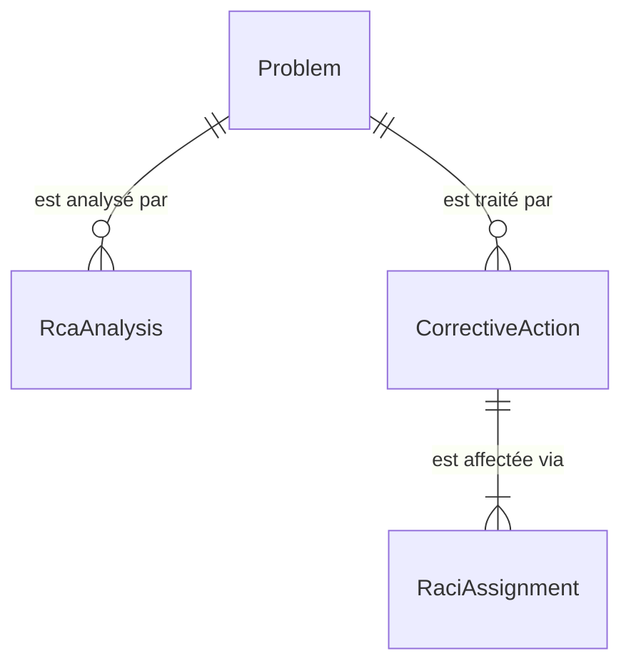
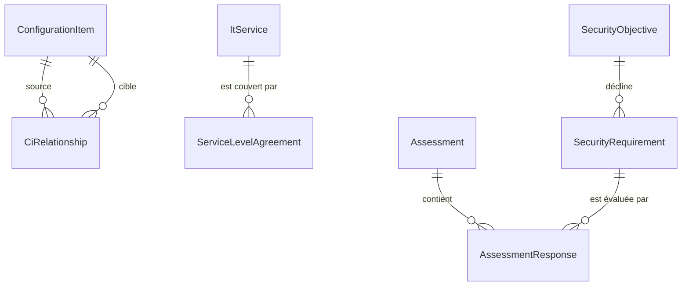

# 🗄️ Base de données

> PostgreSQL 16 via Entity Framework Core 10 (Npgsql). Base et utilisateur `saloha` par défaut, contexte unique `backend/Core/Data/AppDbContext.cs`.

[← Documentation](../readme.md) · [Produit](produit.md) · [Règles métier](regles-metier.md) · [Architecture](architecture.md) · [Base de données](base-de-donnees.md) · [Frontend](frontend.md) · [Exploitation](exploitation.md) · [Sécurité](securite.md) · [Glossaire](glossaire.md)

## Gestion du schéma

Le schéma est tenu par les **migrations EF** (`backend/Core/Data/Migrations`), appliquées
au démarrage de l'API par `DatabaseSchema.Migrate` (`backend/Core/Data/DatabaseSchema.cs`) ;
l'historique est dans la table `__EFMigrationsHistory`
([ADR-0008](../decisions/adr-0008-migrations-ef.md)).

| Migration | Contenu |
|---|---|
| `Initial` | Schéma du module Problèmes : `Problems`, `Analyses`, `Actions`, `RaciAssignments` — identique à ce que créait `EnsureCreated` avant les modules ITIL 4 |
| `Lot1Validations` | Colonnes des validations du lot 1 : `Incidents.ResolutionCode`, `Incidents.FirstResponseAt`, `ServiceRequests.RejectionReason`, `Changes.RejectionReason`, `Improvements.AbandonReason`, `Problems.ClosureCode`, `Problems.ResolvedAt` |
| `IncidentSlaMetrics` | Colonnes des indicateurs d'incident : `Incidents.ResolutionDueAt` (INC-21), `Incidents.OccurredAt` (INC-27), `Incidents.FirstContactResolution`, `Incidents.OwnerChanged` (INC-23) |
| `KnowledgeLifecycle` | Colonnes du cycle des articles : `KnowledgeArticles.SubmittedAt`, `SubmittedBy` (KB-21), `LastReviewedAt`, `LastReviewedBy`, `ArchiveRequestedAt`, `ArchiveRequestedBy`, `ArchiveRequestReason` (KB-17) |
| `ProjectManagement` | Le projet et ses composants : `Projects`, `ProjectPhases`, `Milestones`, `Deliverables`, `Sprints`, `WorkItems`, `ProjectRisks`, `ProjectIssues` ([gestion de projet](processus/gestion-de-projet.md)) |
| `Lot1RightsAndStatuses` | Colonnes de l'étape 4 du lot 1 (droits et statuts) : `Incidents.ReopenCount`, `Incidents.ReopenReason` (INC-11), `ServiceRequests.CancelledAt` (REQ-09) |
| `DuplicateDismissals` | Table `DuplicateDismissals` : paires écartées (« pas un doublon », ADM-42) — type, identifiants dans l'ordre croissant (unique), auteur, date |
| `ChangeFollowUps` | Colonnes `Changes.ConflictComment` (CHG-22) et `Changes.ImplementedAt` (CHG-31) |
| `RegulatoryNotifications` | Colonnes de l'incident de sécurité : `Incidents.IsSecurity`, `QualifiedAt`, `QualifiedBy`, `Nis2Important`, `Nis2Reason`, `PersonalDataBreach`, `PersonalDataBreachReason` (INC-40, INC-41) ; table `RegulatoryNotifications` (`DRG-AAAA-NNNN`) : incident (clé étrangère, suppression en cascade), régime, autorité, prise de connaissance, échéances et envois, contenu, versions envoyées ; unique par incident et régime (DRG-03) |
| `Hypervisors` | Colonne `SshHostKeys.Protocol` (ssh pour les clés existantes, tls pour les certificats d'hyperviseurs) ; table `RelationProposals` (relation proposée entre deux actifs du sas, unique par source, cible et type, suppression en cascade) (CFG-54, CFG-55) |
| `SshInventory` | Colonnes `DiscoveredAssets.Services`, `ListeningPorts` ; tables `DiscoveredSoftware` (logiciels d'un actif du sas, suppression en cascade) et `SshHostKeys` (clé d'hôte par périmètre, adresse et port, unique ; empreinte en attente) (CFG-52, CFG-53) |
| `SnmpV3Interfaces` | Colonnes `DiscoveryCredentials.AuthProtocol`, `PrivProtocol` (SNMP v3) et `DiscoveredAssets.Interfaces` (table des interfaces lue par SNMP) (CFG-51) |
| `PassiveFingerprint` | Colonne `DiscoveredAssets.Banners` (bannières SSH et HTTP, CFG-49) ; table `MacVendors` : préfixe OUI (clé), constructeur, date d'import — vide tant que l'Admin n'a pas importé le registre de l'IEEE (CFG-50) |
| `Categories` | Table `Categories` : catégories d'incident et de problème (ADM-50) — pratique, nom (unique par pratique), active, auteur, date ; reprise des catégories déjà saisies (ADM-52) |
| `LastLogins` | Table `LastLogins` : compte (clé, minuscules) et date de dernière connexion, rien d'autre ; purge quotidienne après 13 mois sans connexion (ADM-12) |
| `CmdbDiscovery` | `ConfigurationItems` : identification technique (`IpAddress`, `MacAddress`, `OperatingSystem`), portefeuille applicatif (`AppCode`, `BusinessUnit`, `BusinessOwner…`, `TechnicalOwner…`, `Criticality`, `RtoHours`, `RpoHours`, `GdprSensitive`, `Nis2Scope`, `AppLifecycle`), actifs matériels (`Vendor`, `Model`, `SerialNumber`, `PurchaseDate`, `WarrantyExpiry`, `EndOfSupport`), nulles (booléens faux) pour l'existant ; index sur `SerialNumber`, `MacAddress`, `AppCode`. Tables `DiscoveredAssets`, `DiscoveryJobs`, `DiscoveryCredentials` (avec `PerimeterId`) et `EndOfLifeRules` (CFG-39 à CFG-48) |
| `Notifications` | Tables `Notifications` (destinataire : `RecipientType` User, Group ou Managers et `RecipientId` ; `PerimeterId`, cible, référence, titre, événement, auteur, date ; index sur destinataire et date) et `NotificationReads` (clé : notification et compte) — SOC-21 |
| `ChangeCabFreezeModels` | Tables `ChangeApprovals` (CHG-20 : changement — FK cascade —, approbateur, décision, commentaire, date ; unique par changement et approbateur), `ChangeFreezes` (CHG-25 : début, fin, motif, auteur), `StandardChangeModels` (CHG-26 : nom, description, plans, risque, actif, auteur, dates) ; `Changes.StandardModelId` (FK, suppression du modèle refusée tant qu'un changement en vient) |
| `ChangeActualDatesReview` | `Changes.ActualStart`, `ActualEnd` (CHG-14), `PirNotes` (CHG-15), nulles pour l'existant |
| `RequestCatalog` | Table `RequestCatalogItems` (nom, description, service — mise à null à sa suppression —, approbation requise, délai cible, groupe d'exécution, actif, auteur, dates) ; `ServiceRequests.CatalogItemId` (FK, suppression du modèle refusée tant qu'une demande en vient) — REQ-20 à REQ-23 |
| `AgreementComplianceTarget` | `Agreements.ComplianceTarget` (numeric(5,2), nul pour l'existant : pas d'alerte) — SLM-20, SLM-23 |
| `ServiceHoursOnHold` | `Services.WorkingDays`, `OpeningTime`, `ClosingTime`, `Holidays`, `TimeZone` (SLM-14) ; `Incidents.OnHoldReason` (INC-07), `OnHoldSince`, `HeldMinutes` (INC-22, 0 pour l'existant) |
| `ServiceCatalogLinks` | `ServiceId` (FK → `Services`, mise à null à la suppression du service, index) sur `Incidents`, `Problems`, `ServiceRequests` ; `ServiceRequests.AffectedService` ; reprise : un `AffectedService` égal (casse ignorée) au nom d'un service rattache l'incident ou le problème à ce service (SLM-10, INC-20) |
| `AgreementReviewResponse` | `Agreements.ResponseHoursP1` à `P4` (SLM-13), `Incidents.ResponseDueAt` ; table `AgreementReviews` (SLM-22 : SLA, date, auteur, constats, décisions, prochaine revue ; FK cascade) |
| `AssessmentEvidence` | Table `AssessmentEvidences` (NIS-08) : évaluation (FK, cascade), exigence, `TargetType`, `TargetId`, `Reference`, `Title` recopiés, `CreatedBy`, `CreatedAt` ; unique par (évaluation, exigence, type, cible) |
| `AssessmentNextDate` | `Assessments.NextAssessmentDate` (NIS-16), nulle pour l'existant : fixée à la prochaine validation |
| `ProblemReopenActionApproval` | `Problems.ReopenReason` (PRB-10) ; `Actions.ApprovalRequestedAt`, `ApprovalRequestedBy` (PRB-25), `ChangeId`, `ChangeReference` (PRB-27) ; colonnes nulles |
| `CiVerification` | `ConfigurationItems.LastVerifiedAt`, `ConfigurationItems.LastVerifiedBy` (CFG-15), nulles pour l'existant |
| `ImprovementSourcePriority` | `Improvements.Source` (« Suggestion » pour l'existant, CSI-10), `Improvements.Value`, `Improvements.Effort` (CSI-12) |
| `Comments` | Table `Comments` (SOC-24) : `TargetType`, `TargetId` (comme un lien), `Visibility` (`Public` ou `Note`), `Body` (4 000), `Author`, `AuthorDisplayName`, `CreatedAt` ; index sur (`TargetType`, `TargetId`) |
| `AssessmentReferentialVersion` | `Assessments.ReferentialVersion` (les évaluations existantes reçoivent la version embarquée, ReCyF v2.5) et `Assessments.FrozenRequirementsJson` (NIS-18) |
| `ProblemOwner` | `Problems` passe sur le socle `Record` : colonnes `OwnerType`, `OwnerId`, `OwnerDisplayName` (gestionnaire du problème, PRB-21) |
| `Perimeters` | Tables `Perimeters` (nom unique, description, suppression douce) et `PerimeterAssignments` (principal AD utilisateur ou groupe, rôle Manager ou User ; unique par périmètre, principal et rôle) ; périmètre « Organisation » (Id 1) créé ; colonne `PerimeterId` (FK, index, défaut 1) sur `Problems` et chaque table de pratique : l'existant est rattaché à « Organisation » ([périmètres](perimetres.md), PER-10) |
| `AuditJournal` | Table `AuditEntries` du journal d'audit (SOC-20) : type et identifiant de l'enregistrement, référence recopiée, action, champ, ancienne et nouvelle valeur, motif, auteur, date ; index sur (type, identifiant) et sur la date |
| `ItilModules` | Les dix tables des autres processus et des liens (`ItemLinks`, `Incidents`, `ServiceRequests`, `Changes`, `ConfigurationItems`, `CiRelationships`, `Services`, `Agreements`, `KnowledgeArticles`, `Improvements`) ; aucune modification des tables existantes |

**Reprise d'une base créée par `EnsureCreated`** (installations antérieures, sans
historique) : au démarrage, si `__EFMigrationsHistory` n'existe pas mais que `Problems`
existe, l'API inscrit `Initial` comme appliquée — et `ItilModules` si `Incidents` existe
aussi —, puis applique les migrations restantes. Les données sont conservées.

Faire évoluer le modèle : [exploitation § Évolutions de schéma](exploitation.md#évolutions-de-schéma).

## Entités — module Gestion des problèmes

Source : `backend/Modules/ProblemManagement/Models/Entities.cs`.

| `DbSet` | Entité | Table |
|---|---|---|
| `Problems` | `Problem` | `Problems` |
| `Analyses` | `RcaAnalysis` | `Analyses` |
| `Actions` | `CorrectiveAction` | `Actions` |
| `RaciAssignments` | `RaciAssignment` | `RaciAssignments` |

### Problem

| Champ | Type | Règle |
|---|---|---|
| `Reference` | texte (20) | **unique** (index) — `PRB-AAAA-NNNN` |
| *Colonnes du socle* | | `Problem` dérive de `Record` depuis la migration `ProblemOwner` : périmètre, responsable AD (`OwnerType`, `OwnerId`, `OwnerDisplayName` = gestionnaire du problème, PRB-21), traçabilité ([socle](#entités--socle-commun-des-processus)) |
| `Title` | texte (200) | |
| `Description` | texte | |
| `Status` | texte (30) | `Nouveau`, `En analyse`, `Erreur connue`, `Résolu`, `Clos` |
| `Impact` | texte (10) | `Faible`, `Moyen`, `Élevé` |
| `Urgency` | texte (10) | `Faible`, `Moyenne`, `Élevée` |
| `Priority` | texte (10) | `P1`…`P4`, **dérivée** impact × urgence |
| `Category`, `AffectedService` | texte (100 / 150) | |
| `CreatedBy`, `CreatedByDisplayName` | texte (100 / 200) | `sAMAccountName` et nom AD du déclarant |
| `KnownErrorWorkaround` | texte, nullable | contournement (erreur connue) |
| `RootCause` | texte, nullable | cause racine **validée** |
| `CreatedAt`, `UpdatedAt` | horodatage UTC | |
| `ClosedAt` | horodatage UTC, nullable | posé au passage à `Clos` — base du MTTR |
| `ClosureCode` | texte (30), nullable | `Corrigé`, `Erreur connue acceptée`, `Doublon`, `Non retenu` — exigé à la clôture, effacé à la réouverture (PRB-13) |
| `ResolvedAt` | horodatage UTC, nullable | posé à l'entrée en `Résolu`, effacé au retour en analyse (PRB-14) |

### RcaAnalysis

| Champ | Type | Règle |
|---|---|---|
| `ProblemId` | FK → `Problem` | cascade |
| `Method` | texte (20) | `FIVE_WHYS`, `ISHIKAWA`, `FTA` |
| `DataJson` | texte (JSON) | structure propre à la méthode, voir ci-dessous |
| `Conclusion` | texte, nullable | cause racine identifiée par l'analyse |
| `CreatedBy`, `CreatedAt`, `UpdatedAt` | | |

### CorrectiveAction

| Champ | Type | Règle |
|---|---|---|
| `ProblemId` | FK → `Problem` | cascade |
| `Title` (200), `Description` | texte | |
| `Status` | texte (20) | `À faire`, `En cours`, `Terminée`, `Annulée` |
| `DueDate` | horodatage, nullable | échéance — base du calcul de retard |
| `CompletedAt` | horodatage, nullable | posé au passage à `Terminée` |
| `CreatedBy`, `CreatedAt` | | |

### RaciAssignment

| Champ | Type | Règle |
|---|---|---|
| `CorrectiveActionId` | FK → `CorrectiveAction` | cascade |
| `Role` | texte (1) | `R`, `A`, `C`, `I` |
| `AssigneeType` | texte (10) | `User` ou `Group` |
| `AssigneeId` | texte (200) | `sAMAccountName` (utilisateur) ou `cn` (groupe AD) |
| `AssigneeDisplayName` | texte (250) | nom d'affichage au moment de l'affectation |

Les identités sont des **chaînes AD**, sans table d'utilisateurs : un renommage dans l'AD
n'est pas répercuté sur les enregistrements existants.

### Suppressions

En cascade : `Problem` → `RcaAnalysis` et `CorrectiveAction` → `RaciAssignment`.

## Formats JSON des analyses (`DataJson`)

Le JSON permet d'ajouter une méthodologie sans évolution de schéma.

- **5 Pourquoi** : `{ "problem": "...", "whys": ["...", ...], "rootCause": "..." }`
- **Ishikawa (6M)** : `{ "categories": { "Méthode": ["..."], ... }, "rootCause": "..." }`
- **FTA** : arbre récursif `{ "root": { "label": "...", "gate": "OR|AND", "children": [...] }, "rootCause": "..." }`

## Entités — socle commun des processus

Les entités des autres processus dérivent de `Record` (`backend/Core/Records/Record.cs`,
classe non mappée) : chaque processus a sa table, avec ces colonnes communes.

| Champ | Type | Règle |
|---|---|---|
| `Reference` | texte (20) | **unique** (index par table) — `XXX-AAAA-NNNN` |
| `Title` | texte (200) | obligatoire ; porte le *nom* pour un CI ou un service |
| `Description` | texte | |
| `Status` | texte (30) | liste fermée propre au processus ([règles métier](regles-metier.md#5-règles-communes-aux-processus)) |
| `OwnerType`, `OwnerId`, `OwnerDisplayName` | texte (10 / 200 / 250), nullable | responsable AD : `User` ou `Group` |
| `CreatedBy`, `CreatedByDisplayName` | texte (100 / 200) | |
| `CreatedAt`, `UpdatedAt` | horodatage UTC | |
| `PerimeterId` | entier, FK → `Perimeters` (suppression refusée), index | périmètre de l'enregistrement, « Organisation » (1) par défaut ([PER-04, PER-10](perimetres.md)) ; aussi sur `Problems` |

### Tables des processus

| Table (entité) | Préfixe | Colonnes propres |
|---|---|---|
| `Incidents` (`Incident`) | INC | `ResolutionCode`, `FirstResponseAt`, `ReopenCount`, `ReopenReason`, `ResolutionDueAt`, `OccurredAt`, `FirstContactResolution`, `OwnerChanged`, `Impact`, `Urgency`, `Priority` (dérivée), `Category`, `AffectedService`, `IsMajor`, `Resolution`, `ResolvedAt`, `ClosedAt` |
| `ServiceRequests` (`ServiceRequest`) | REQ | `RejectionReason`, `RequestedItem`, `RequestedFor`, `RequestedForDisplayName`, `DueDate`, `ApprovedBy`, `ApprovedAt`, `FulfilledAt`, `ClosedAt`, `CancelledAt` |
| `Changes` (`Change`) | CHG | `RejectionReason`, `ChangeType`, `Risk`, `PlannedStart`, `PlannedEnd`, `ImplementationPlan`, `BackoutPlan`, `Outcome`, `AuthorizedBy`, `AuthorizedAt`, `ClosedAt` |
| `ConfigurationItems` (`ConfigurationItem`) | CI | `CiType`, `Environment`, `Location`, `LastVerifiedAt`, `LastVerifiedBy`, `IpAddress`, `MacAddress`, `OperatingSystem` ; portefeuille applicatif (`AppCode`…`AppLifecycle`) et actifs matériels (`Vendor`…`EndOfSupport`) : [§ 3 de la pratique](processus/gestion-de-la-configuration.md#3-données) |
| `Services` (`ItService`) | SVC | `Criticality`, `ServiceHours` |
| `Agreements` (`ServiceLevelAgreement`) | SLA | `ServiceId` (FK → `Services`, cascade), `Customer`, `AvailabilityTarget` (décimal 5,2), `ResolutionHoursP1`…`P4`, `ValidFrom`, `ValidTo`, `ReviewDate` |
| `KnowledgeArticles` (`KnowledgeArticle`) | KB | `ArticleType`, `Content` (Markdown), `Keywords`, `ReviewDate`, `PublishedBy`, `PublishedAt`, `SubmittedAt`, `SubmittedBy`, `LastReviewedAt`, `LastReviewedBy`, `ArchiveRequestedAt`, `ArchiveRequestedBy`, `ArchiveRequestReason` |
| `Improvements` (`Improvement`) | AMI | `Source`, `Value`, `Effort`, `AbandonReason`, `Step` (1–7), `Priority`, `Benefit`, `Baseline`, `Target`, `Outcome`, `DueDate`, `ValidatedBy`, `ValidatedAt`, `CompletedAt` |
| `Assessments` (`Assessment`) | EVA | `EntityCategory` (Entité importante, Entité essentielle), `ValidatedBy`, `ValidatedAt`, `ReferentialVersion` (texte 100), `FrozenRequirementsJson` (exigences figées à la validation, NIS-18) |
| `Projects` (`Project`) | PRJ | `Method`, `Components` (liste séparée par des virgules), `StartDate`, `TargetEndDate`, `Budget`, `ActualCost` (décimal 14,2), business case (`Justification`, `ExpectedBenefits`, `ExpectedCosts`, `MajorRisks`), tolérances (`ToleranceDays`, `ToleranceCostPercent` décimal 6,2, `ToleranceScope`, `ToleranceQuality`), `ValidatedBy`, `ValidatedAt`, `AbandonReason`, `ClosedAt` |

- **Référentiel NIS 2** (migration `ComplianceAssessment`) : `SecurityObjectives` (`Id` =
  numéro 1 à 20, `Title`, `Pillar`) et `SecurityRequirements` (`Code` unique, `ObjectiveId`,
  `Theme`, `ForImportant`, `ForEssential`, `IsoControls`, `Order`, `Text`, `TextImportedAt`),
  alignées au démarrage sur les CSV embarqués sans écraser `Text`
  ([ADR-0012](../decisions/adr-0012-referentiel-nis2-structure-versionnee-texte-importe.md)).
  `AssessmentResponses` : `AssessmentId` (cascade), `RequirementId`, `Score` (0–3, null si
  non applicable), `NotApplicable`, `Justification`, `UpdatedBy`, `UpdatedAt` ; une réponse
  par exigence et par évaluation.

- **Composants d'un projet** (migration `ProjectManagement`) : chaque table porte `ProjectId`
  (FK → `Projects`, cascade), `CreatedAt`, `CreatedBy`. `ProjectPhases` (`Kind` Phase ou
  Étape, `Name`, `Order`, `PlannedStart`, `PlannedEnd`, `Status`, `ApprovedBy`, `ApprovedAt`),
  `Milestones` (`Name`, `PhaseId`, `DueDate`, `AchievedAt`), `Deliverables` (`Name`,
  `Description`, `PhaseId`, `DueDate`, `Status`, `ValidatedBy`, `ValidatedAt`), `Sprints`
  (`Name`, `Goal`, `StartDate`, `EndDate`, `Status`), `WorkItems` (`Type`, `Title`,
  `Description`, `AcceptanceCriteria`, `Points`, `Rank`, `SprintId` indexé, `Status`,
  `AssigneeId`, `AssigneeDisplayName`, `CompletedAt`), `ProjectRisks` (`Title`,
  `Description`, `Probability`, `Impact`, `Response`, `OwnerDisplayName`, `Status` ; la
  criticité est calculée, pas stockée), `ProjectIssues` (`Type`, `Title`, `Description`,
  `Severity`, `Status`, `Resolution`, `ClosedAt`).
- **`CiRelationships`** : `SourceId`, `TargetId` (FK → `ConfigurationItems`, cascade des deux
  côtés), `Type` (`Dépend de`, `Héberge`, `Fait partie de`, `Se connecte à`).
- **Découverte** (migration `CmdbDiscovery`, [§ 3.5 de la pratique](processus/gestion-de-la-configuration.md#35-découverte-et-sas-de-staging)) :
  `DiscoveredAssets` (`MatchedCiId` FK → `ConfigurationItems` mise à null à sa suppression,
  `JobId` FK → `DiscoveryJobs` mise à null ; index sur périmètre et statut),
  `DiscoveryJobs` (`CredentialId` FK → `DiscoveryCredentials`, suppression refusée tant
  qu'une tâche l'utilise), `DiscoveryCredentials` (`EncryptedSecret` : `v1:` puis nonce,
  étiquette et chiffré AES-256-GCM en base64, jamais exposé), `EndOfLifeRules` (`Product`
  unique, `EndOfSupport`, `Notes`).
- **`SearchPassages`** (socle, `backend/Core/Search/SearchPassage.cs`, migration `SearchIndex`) :
  index **dérivé** de la recherche hybride, reconstructible, jamais saisi. `SourceType`,
  `SourceId`, `Reference`, `Title`, `Status`, `Ordinal`, `Text` (passage de 800 caractères
  au plus), `Embedding` (`real[]`, vecteur normalisé de 1024 dimensions, null sans service
  d'embeddings), `EmbeddingModel`, `SearchVector` (colonne **générée** par PostgreSQL :
  `to_tsvector('french', …)` sur titre et texte, index GIN), `IndexedAt`
  ([recherche](recherche.md), [ADR-0013](../decisions/adr-0013-recherche-hybride-service-embeddings-separe.md)).
- **`ItemLinks`** (socle, `backend/Core/Links/ItemLink.cs`) : `FromType`, `FromId`, `ToType`,
  `ToId`, `CreatedBy`, `CreatedAt`. Types : `problem`, `incident`, `request`, `change`, `ci`,
  `service`, `agreement`, `article`, `improvement`, `assessment`, `project`. Pas de clé étrangère (une extrémité
  peut appartenir à n'importe quelle table) : les liens d'un enregistrement sont supprimés
  avec lui par l'API, et un lien orphelin est ignoré à la lecture. Index sur
  (`FromType`, `FromId`) et (`ToType`, `ToId`).
- Les dates saisies sans fuseau sont lues en UTC (`Dates.Utc`) : les colonnes sont en `timestamptz`.

## Ajouter les entités d'un module

1. Déclarer les entités dans `backend/Modules/<Processus>/Models/` (dérivées de `Record` pour un processus).
2. Ajouter les `DbSet`, l'index unique de la référence et la configuration (`OnModelCreating`) dans `AppDbContext`.
3. Déclarer les **DTO de réponse** dans `Models/Views.cs` (`XxxView.From(entité)`) : l'API ne renvoie jamais une entité
   ([ADR-0016](../decisions/adr-0016-reponses-de-l-api-en-dto.md) ; `EntityGuard` le refuse à l'exécution). Un nouveau
   champ n'est exposé qu'en l'ajoutant à la vue ; l'instantané `openapi-reponses.json` se met à jour avec
   `UPDATE_OPENAPI_SNAPSHOT=1 dotnet test`.
4. Documenter les tables ici.
