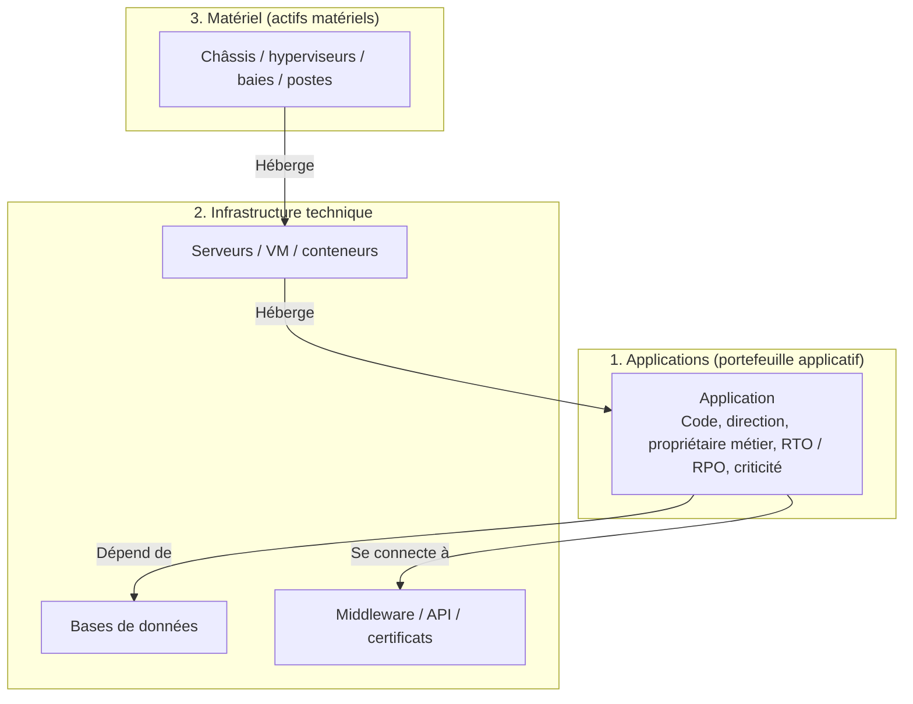
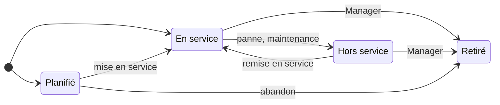
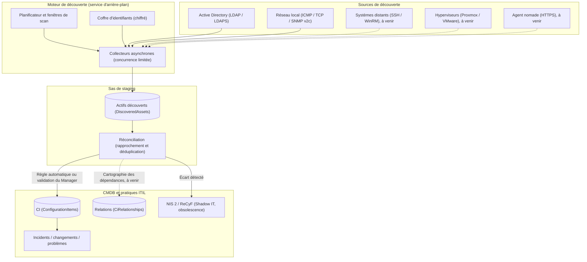
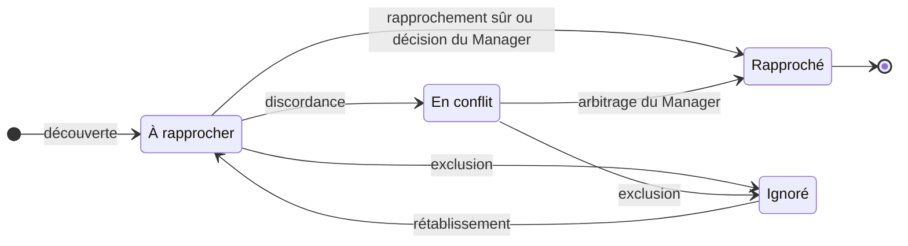

# 🧩 Gestion de la configuration

> Pratique ITIL 4 *Service configuration management*. Code :
> `backend/Modules/ServiceConfigurationManagement`,
> `frontend/src/modules/service-configuration-management`. Préfixe des règles : **CFG**.
> Socle commun et conventions (✅ / 🔜, lots) : [règles métier](../regles-metier.md).

[← Règles métier](../regles-metier.md) · [Toutes les pratiques](readme.md)

## 1. Objectif et périmètre

*Objectif ITIL 4 : s'assurer que des informations exactes et fiables sur la configuration
des services, et sur les éléments de configuration qui les supportent, sont disponibles
quand et où elles sont nécessaires.*

Un **élément de configuration (CI)** est tout composant à gérer pour fournir un service :
application, serveur, base de données, équipement réseau… La base des CI et de leurs
**relations** (CMDB) sert l'analyse d'impact des incidents et des changements. Elle est
alimentée de façon hybride : saisie manuelle et découverte automatique du réseau, qui passe
par un sas de staging (§ 4.2, chantier F13 du [plan d'action](../../plan-action.md)).

La plateforme y tient deux référentiels, qui reprennent le volet configuration de deux
autres pratiques ITIL 4 (§ 3.1) :

- le **portefeuille applicatif** (*application portfolio*, pratique ITIL 4 *Portfolio
  management*) : l'inventaire des applications, de leur gouvernance et de leur cycle de vie ;
- les **actifs matériels** (pratique ITIL 4 *IT asset management*) : l'inventaire du
  matériel physique, de son identification et de son cycle de vie.

Hors périmètre : le volet financier de la gestion des actifs (coûts, contrats, amortissements)
et l'arbitrage du portefeuille (choix d'investissement entre applications ou projets).

## 2. Rôles et droits

| Rôle ITIL | Rôle applicatif | Responsabilités |
|---|---|---|
| Gestionnaire de la configuration | Manager | Garant de l'exactitude de la CMDB, vérifications, retraits, scans et réconciliation du staging, fins de support |
| Propriétaire de CI | Responsable AD du CI | Tient la fiche à jour, la vérifie |
| Contributeur | User | Crée et met à jour les CI et relations |
| Administrateur | Admin | Droits du Manager, suppression, import, coffre d'identifiants |

| Action | User | Manager | Admin | Statut |
|---|---|---|---|---|
| Créer, modifier un CI, gérer ses relations | ✔ | ✔ | ✔ | ✅ |
| Passer un CI à **Retiré** | ✘ | ✔ | ✔ | ✅ CFG-12 |
| Enregistrer une vérification | Propriétaire | ✔ | ✔ | ✅ CFG-15 |
| Consulter le rapport d'inventaire | ✔ | ✔ | ✔ | ✅ CFG-39 |
| Consulter le sas de staging | ✘ | ✔ | ✔ | ✅ CFG-40 |
| Rapprocher, créer en CI, ignorer, rétablir ou supprimer un actif du staging | ✘ | ✔ | ✔ | ✅ CFG-40 |
| Créer, modifier, lancer une tâche de scan | ✘ | ✔ | ✔ | ✅ CFG-46 |
| Supprimer une tâche de scan | ✘ | ✘ | ✔ | ✅ |
| Lire la liste du coffre (noms et types, jamais les secrets) | ✘ | ✔ | ✔ | ✅ CFG-45 |
| Créer, modifier, remplacer le secret, supprimer un identifiant du coffre | ✘ | ✘ | ✔ | ✅ CFG-45 |
| Tenir le référentiel des fins de support | ✘ | ✔ | ✔ | ✅ CFG-47 |
| Importer en masse | ✘ | ✘ | ✔ | 🔜 CFG-30 |
| Supprimer un CI | ✘ | ✘ | ✔ | ✅ |

Les actifs découverts, tâches de scan et identifiants portent un périmètre, comme les CI :
un gestionnaire ne voit et ne traite que ceux des périmètres qu'il gère
([périmètres](../perimetres.md), PER-06). Le référentiel des fins de support est partagé.

## 3. Données

Champs communs (référence `CI-AAAA-NNNN`, nom = titre, description, statut, propriétaire
AD, créateur, dates) : [socle](../regles-metier.md#5-règles-communes-aux-processus).

### 3.1. Modèle à trois couches

Pour qu'une CMDB reste lisible à grande échelle (portefeuille de plus de 1 000
applications), les CI se rangent en trois couches, reliées par les relations du § 3.2 :

1. **Applications (portefeuille applicatif, § 3.3)** : applications logiques, code
   applicatif, direction utilisatrice, duo de gouvernance, criticité, RTO / RPO, NIS 2.
2. **Infrastructure technique** : serveurs, VM, conteneurs, bases de données, middleware et
   API, reliés aux applications par *Héberge*, *Dépend de* et *Se connecte à*.
3. **Matériel (actifs matériels, § 3.4)** : châssis, serveurs physiques, commutateurs,
   baies, postes ; constructeur, numéro de série, garantie, emplacement.

Les flèches suivent le sens des relations (source → cible) ; la propagation d'une panne
suit CFG-05.

### 3.2. Socle commun du CI (`ConfigurationItem`)

| Champ | Type | Oblig. | Valeurs / règle | Statut |
|---|---|---|---|---|
| `CiType` | texte 30 | ✔ | Application, Serveur, Base de données, Réseau, Stockage, Poste de travail, Logiciel, Autre | ✅ |
| `Environment` | texte 20 | ✔ | Production, Recette, Développement, Autre | ✅ |
| `Location` | texte 150 | | Emplacement ; pour le matériel physique : Site > Bâtiment > Salle > Baie > U (CFG-44) | ✅ |
| `Status` | texte 30 | ✔ | Planifié, En service, Hors service, Retiré ; choisi à la création (défaut En service) | ✅ |
| `Owner…` | AD | En service | Propriétaire du CI (CFG-11) | ✅ |
| `IpAddress`, `MacAddress` | texte 45, 17 | | Types Serveur, Réseau, Stockage, Poste de travail. IPv4 ou IPv6 valide ; MAC normalisée `00:1A:2B:3C:4D:5E` (saisie avec tirets, points ou sans séparateur acceptée) ; 400 sinon. Critères de rapprochement (CFG-41) | ✅ |
| `OperatingSystem` | texte 150 | | Système ou micrologiciel ; mis à jour par la découverte ; comparé aux fins de support (CFG-47) | ✅ |
| `Attributes` | clé/valeur | | Autres attributs propres au type (version, éditeur, CPU, mémoire…) | 🔜 CFG-16 |
| `LastVerifiedAt`, `LastVerifiedBy` | date, AD | auto | Dernière vérification | ✅ CFG-15 |
| Services supportés | liens CI ↔ service | | Les services du catalogue reliés au CI (onglet Liens) | ✅ CFG-21 |

**Relation** (`CiRelationships`) : source, cible, type orienté — *Dépend de*, *Héberge*,
*Fait partie de*, *Se connecte à*. ✅

La recherche du registre porte aussi sur le code applicatif, le numéro de série et
l'adresse IP. ✅

### 3.3. Portefeuille applicatif (`CiType` = Application)

Champs de gouvernance des applications, en colonnes dédiées (CFG-43, CFG-48), propres au
type Application (ignorés pour un autre type). « En service » : obligatoires pour un CI En
service ou Hors service, comme le propriétaire (CFG-11) ; un CI Planifié peut s'en passer.

| Champ | Type | Oblig. | Valeurs / règle | Statut |
|---|---|---|---|---|
| `AppCode` | texte 20 | En service | Code applicatif, en majuscules, unique parmi les CI non retirés (ex. `FIN` ou `APP-FIN-001`) | ✅ CFG-43 |
| `BusinessUnit` | texte 100 | En service | Direction métier utilisatrice (ex. Direction financière, RH) | ✅ CFG-43 |
| `BusinessOwner…` | AD | En service | Propriétaire métier (Product Owner / MOA), utilisateur ou groupe | ✅ CFG-43 |
| `TechnicalOwner…` | AD | En service | Responsable technique DSI (Tech Lead / TMA / exploitation) ; peut être le propriétaire du CI | ✅ CFG-43 |
| `Criticality` | texte 10 | En service | Vitale, Majeure, Standard, Mineure | ✅ CFG-43 |
| `RtoHours`, `RpoHours` | entier | | RTO (durée maximale d'interruption) et RPO (perte de données admissible), en heures, positifs | ✅ |
| `GdprSensitive` | booléen | | Traitement de données personnelles ou sensibles au sens du RGPD | ✅ |
| `Nis2Scope` | booléen | | Application du périmètre NIS 2 de l'organisation ; la catégorie d'entité (essentielle, importante) relève de l'[évaluation de conformité](conformite-nis2.md) (NIS-01) | ✅ |
| `AppLifecycle` | texte 30 | auto | Étude, Développement, Homologation, En production, Dépréciée, Retirée ; vide, déduit du statut ; cohérent avec `Status` (§ 4.3, CFG-48) | ✅ CFG-48 |

### 3.4. Actifs matériels (types Serveur, Réseau, Stockage, Poste de travail)

Champs d'identification et de cycle de vie du matériel, en colonnes dédiées (CFG-44),
propres à ces types (ignorés pour un autre type). Ils ne sont exigés que pour les types
Réseau, Stockage et Poste de travail : un CI Serveur peut être une VM.

| Champ | Type | Oblig. | Valeurs / règle | Statut |
|---|---|---|---|---|
| `Vendor` | texte 100 | En service | Constructeur (ex. Cisco, Dell, HP, Fortinet, Synology) | ✅ CFG-44 |
| `Model` | texte 100 | | Modèle commercial et référence constructeur | ✅ |
| `SerialNumber` | texte 100 | En service | Numéro de série ou étiquette d'inventaire, unique parmi les CI non retirés (sans tenir compte de la casse) ; premier critère de rapprochement (CFG-41) | ✅ CFG-44 |
| `PurchaseDate` | date | | Date d'acquisition | ✅ |
| `WarrantyExpiry` | date | | Fin de garantie constructeur | ✅ CFG-39 |
| `EndOfSupport` | date | | Fin de support constructeur (EOL / EOS, CFG-47) | ✅ |

L'emplacement physique précis se saisit dans `Location` (§ 3.2).

### 3.5. Découverte et sas de staging

| Objet | Champs principaux | Usage | Statut |
|---|---|---|---|
| Actif découvert (`DiscoveredAssets`) | `IpAddress`, `MacAddress`, `Hostname`, `SerialNumber`, `Vendor`, `Model`, `DetectedOs`, `DetectedType` (valeurs de `CiType`), `Location`, `OpenPorts`, `Sources` (IpSweep, Snmp, ActiveDirectory : liste des sources qui l'ont vu), `InDirectory`, `Status` (À rapprocher, En conflit, Rapproché, Ignoré), `ConfidenceScore` (0 à 100), `MatchRule`, `SuggestedAction` (UpdateExisting, Conflict, CreateNew), `ConflictReason`, `MatchedCiId`, `JobId`, `FirstSeenAt`, `LastSeenAt`, `ReconciledAt`, `ReconciledBy`, périmètre | Sas de staging avant réconciliation (CFG-40) | ✅ |
| Tâche de scan (`DiscoveryJobs`) | `Name`, `ScanType` (IpSweep, Snmp, ActiveDirectory), `TargetRange` (CIDR ou IP ; BaseDN facultatif pour l'annuaire), `PortList` (balayage), `CredentialId`, `FrequencyHours` (0 : manuelle), `WindowStart`, `WindowEnd`, `IsActive`, `LastRunAt`, `LastStatus` (Jamais lancée, En file, En cours, Réussie, En échec), `LastError`, `LastFoundCount`, périmètre | Planification et suivi des scans (CFG-46) | ✅ |
| Identifiant du coffre (`DiscoveryCredentials`) | `Name`, `CredentialType` (SnmpV2c, WindowsDomain), `Username`, `Domain`, `EncryptedSecret`, `SecretChangedAt`, périmètre | Secrets chiffrés au repos, jamais renvoyés (CFG-45) | ✅ |
| Fin de support (`EndOfLifeRules`) | `Product` (unique, sans tenir compte de la casse), `EndOfSupport`, `Notes` | Référentiel partagé de l'obsolescence (CFG-47) | ✅ |

Types de scan et d'identifiant à venir avec leurs collecteurs : SNMP v3, SSH, WinRM,
hyperviseurs et API cloud (phases 2 et 3 du chantier F13), agent nomade (phase 4). 🔜

## 4. Cycle de vie

### 4.1. CI

Statut choisi à la création ; seules les transitions ci-dessous sont permises (CFG-10,
SOC-05). Les cycles du portefeuille applicatif et des actifs matériels (§ 4.3, § 4.4) se lisent sur
ces mêmes statuts.

| De → Vers | Qui | Conditions (400 sinon) | Effets | Statut |
|---|---|---|---|---|
| — → Planifié ou En service | Tous | Nom, type, environnement ; En service : propriétaire (CFG-11) et champs « En service » des § 3.3 et 3.4 | Référence | ✅ |
| Planifié → En service | Tous | Propriétaire renseigné (CFG-11) ; champs « En service » des § 3.3 et 3.4 (CFG-43, CFG-44) | Cycle applicatif aligné (CFG-48) | ✅ |
| En service ⇄ Hors service | Tous | Champs « En service » des § 3.3 et 3.4 | | ✅ |
| En service, Hors service, Planifié → Retiré | Manager | Aucun incident ni changement ouvert relié (CFG-13) | Relations conservées (historique), CI exclu des nouveaux liens (CFG-14) ; cycle applicatif « Retirée » | ✅ CFG-12 |
| Retiré → … | — | Statut final | | ✅ CFG-10 |

### 4.2. Découverte et sas de staging

Le moteur de découverte est un service d'arrière-plan de l'API, asynchrone et non intrusif
(une tâche à la fois, concurrence limitée, CFG-46), qui puise ses secrets dans le coffre
d'identifiants (CFG-45). Aucune donnée découverte n'entre directement dans la CMDB : chaque
actif transite par le sas de **staging** (`DiscoveredAssets`), où le moteur de
réconciliation le rapproche des CI existants (CFG-41).

Collecteurs, par phase du chantier F13 : annuaire AD et balayage IP (ping, ports TCP
témoins, DNS inverse, table ARP locale) ✅ ; SNMP v2c en lecture seule (MIB-II, numéro de
série et modèle de l'ENTITY-MIB) ✅ ; SNMP v3, empreinte OUI et bannières 🔜 (phase 2) ;
SSH, WinRM, hyperviseurs et cartographie des dépendances 🔜 (phase 3) ; agent nomade 🔜
(phase 4).

| De → Vers | Qui | Conditions | Effets | Statut |
|---|---|---|---|---|
| — → À rapprocher | Système | Équipement vu par une tâche (IP, MAC, nom d'hôte ou numéro de série connu) | Actif créé avec son score (CFG-41). Un équipement déjà présent dans le périmètre (même série, même MAC, même nom d'hôte, ou même IP sans indice contraire) est mis à jour, pas dupliqué : sources fusionnées, `LastSeenAt`, IP, ports ; le système le plus précis l'emporte (annuaire et SNMP avant le balayage), un FQDN remplace un nom court | ✅ CFG-40 |
| À rapprocher → Rapproché | Système | Score ≥ 80 et action UpdateExisting (série, MAC ou nom d'hôte), `Discovery:AutoReconcile` actif (défaut) | Identification technique du CI mise à jour ; jamais de création automatique | ✅ CFG-41 |
| À rapprocher → Rapproché | Manager | Décision sur la fiche de l'actif : CI proposé, autre CI ou création | Mise à jour du CI choisi (même périmètre, non retiré, serveur ou équipement), ou création d'un CI soumise aux règles du registre (CFG-11, CFG-17, CFG-43, CFG-44) dans le périmètre de l'actif ; `ReconciledBy`, `ReconciledAt` | ✅ CFG-40 |
| — → En conflit | Système | Rapprochement par la seule IP (score 50), critères contradictoires (même nom ou même MAC, autre numéro de série), ou numéro de série déjà porté par un autre CI | Motif (`ConflictReason`) affiché sur la fiche ; rien n'est modifié dans la CMDB | ✅ CFG-41 |
| En conflit → Rapproché | Manager | Arbitrage sur le CI cible | Mise à jour ou création du CI, comme ci-dessus | ✅ CFG-40 |
| À rapprocher, En conflit → Ignoré | Manager | Équipement personnel, invité ou hors CMDB | Actif conservé (un nouveau scan ne le recrée pas), plus proposé à la réconciliation | ✅ CFG-40 |
| Ignoré → À rapprocher | Manager | Exclusion faite par erreur | Le prochain scan recalcule son rapprochement | ✅ CFG-40 |
| Rapproché (scan suivant) | Système | Le CI rapproché existe et n'est pas retiré | Identification technique du CI tenue à jour ; un CI supprimé rend l'actif au rapprochement | ✅ CFG-41 |

Un actif se supprime du sas (gestionnaire) ; il reviendra au prochain scan s'il est toujours
présent.

### 4.3. Portefeuille applicatif

Une application traverse un cycle de gouvernance plus long qu'une machine. Il est porté
par `AppLifecycle`, qui reste cohérent avec le statut du CI (CFG-48) :

```mermaid
stateDiagram-v2
    direction LR
    [*] --> Etude : cadrage
    Etude --> Developpement : projet validé
    Developpement --> Homologation : recette métier
    Homologation --> EnProduction : mise en production
    EnProduction --> Depreciee : remplacement planifié
    Depreciee --> Retiree : décommissionnement
    Retiree --> [*]
    Etude : Étude
    Developpement : Développement
    EnProduction : En production
    Depreciee : Dépréciée
    Retiree : Retirée
```

| `AppLifecycle` | Statut du CI | Rôle dans la DSI | Usage attendu |
|---|---|---|---|
| **Étude** | Planifié | Projet en cadrage, rattachement budgétaire | Relié aux projets |
| **Développement** | Planifié | Application en construction | Relié aux projets |
| **Homologation** | Planifié | Recette fonctionnelle, tests d'acceptation | Changements de pré-production |
| **En production** | En service ou Hors service | Application active | Incidents, changements, problèmes, SLA |
| **Dépréciée** | En service ou Hors service | Maintenue, appelée à être remplacée | Incidents ; pas de nouveau projet |
| **Retirée** | Retiré | Arrêtée et archivée | Aucun nouveau lien (CFG-14) |

Seul le dernier usage est contrôlé (CFG-14) ; les autres sont indicatifs.

### 4.4. Actifs matériels

Les équipements physiques suivent le cycle du CI (§ 4.1), lu en étapes du cycle de vie
d'un actif :

| Étape de l'actif | Statut du CI |
|---|---|
| Réception, en stock | Planifié |
| Déployé, brassé | En service |
| En panne, en maintenance | Hors service |
| Réformé (DEEE, obsolescence, panne irréversible) | Retiré |

## 5. Règles de gestion

| ID | Règle | Statut | Lot |
|---|---|---|---|
| CFG-01 | Un CI porte un nom, un type, un environnement, un emplacement et un propriétaire ; statut choisi à la création (« En service » par défaut) | ✅ | |
| CFG-02 | **Relations** orientées entre CI (*Dépend de*, *Héberge*, *Fait partie de*, *Se connecte à*) ; la fiche montre les relations sortantes et entrantes | ✅ | |
| CFG-03 | Pas de relation d'un CI vers lui-même (400), ni de doublon même source, cible et type (409) | ✅ | |
| CFG-04 | **Vue d'impact** transitive : **en aval**, les CI touchés si ce CI tombe ; **en amont**, ceux dont il dépend | ✅ | |
| CFG-05 | **Sens de propagation** d'une panne : « A *dépend de* / *se connecte à* B » — la panne de B touche A ; « A *héberge* / *fait partie de* B » — la panne de A touche B | ✅ | |
| CFG-06 | Dans la vue d'impact, chaque CI n'apparaît qu'une fois, à sa plus courte distance, avec la relation par laquelle il est atteint ; un cycle ne boucle pas | ✅ | |
| CFG-07 | Registre filtrable par type (`type`), statut et texte ; le texte cherche aussi le code applicatif, le numéro de série et l'adresse IP | ✅ | |
| CFG-10 | **Transitions contraintes** selon le § 4.1 (SOC-05) ; Retiré est final | ✅ | 1 |
| CFG-11 | Le **propriétaire** est obligatoire pour un CI En service | ✅ | 1 |
| CFG-12 | **Retirer** un CI : Manager uniquement | ✅ | 1 |
| CFG-13 | Un CI relié à un **incident ou changement ouvert** ne peut pas être retiré (400, avec les références en cause) | ✅ | 1 |
| CFG-14 | Un CI **Retiré** ne peut plus être relié à un nouvel incident, changement ou CI (400) ; ses liens existants restent visibles | ✅ | 1 |
| CFG-15 | **Vérification** : le propriétaire ou un Manager atteste que la fiche est exacte (`LastVerifiedAt`) ; un CI En service non vérifié depuis **12 mois** remonte en relance au propriétaire. Vérification par `POST /api/configuration-items/{id}/verify` ; relance par notification (relevé périodique). | ✅ | |
| CFG-16 | **Attributs par type** : chaque type de CI définit des attributs facultatifs (Serveur : CPU, mémoire ; Application : version, éditeur, URL ; Poste de travail : utilisateur…). L'identification technique, le portefeuille applicatif et les actifs matériels (§ 3.2 à 3.4) sont des colonnes dédiées, hors de ces attributs | 🔜 | 3 |
| CFG-17 | **Unicité** : deux CI non retirés ne peuvent pas avoir le même nom dans le même environnement (409) | ✅ | 1 |
| CFG-18 | Un CI **Hors service** relié à un service En service signale ce service « dégradé » sur la fiche du service | 🔜 | 2 |

Règles du chantier F13 (découverte automatique et CMDB augmentée, [plan
d'action](../../plan-action.md#découverte-automatique-et-cmdb-augmentée-f13)) :

| ID | Règle | Statut | Lot |
|---|---|---|---|
| CFG-39 | **Rapport d'inventaire** : portefeuille applicatif (code, direction, duo de gouvernance, criticité, cycle, RTO / RPO, RGPD, NIS 2, gouvernance complète ou non) et actifs matériels (constructeur, modèle, série, emplacement, IP, système, garantie, fin de support), sur les périmètres de l'utilisateur, CI retirés exclus par défaut ; synthèse (applications gouvernées, actifs sans numéro de série, fins de support dépassées ou proches, garanties expirées), export CSV et impression. État de garantie : Expirée, Expire bientôt (moins de 6 mois), Sous garantie, Non renseigné | ✅ | 3 |
| CFG-40 | **Sas de staging obligatoire** : tout actif découvert entre dans `DiscoveredAssets` au statut À rapprocher ; aucun CI n'est créé ni modifié par la découverte sans réconciliation (§ 4.2). Un CI créé depuis le staging respecte les règles du registre (CFG-11, CFG-17, CFG-43, CFG-44) et prévient son propriétaire (SOC-21) | ✅ | 3 |
| CFG-41 | **Rapprochement et déduplication** : un actif est comparé aux CI non retirés de son périmètre et de type Serveur, Réseau, Stockage ou Poste de travail (une application homonyme d'un hôte n'est jamais rapprochée), dans l'ordre : 1. numéro de série (score 100), 2. adresse MAC (90), 3. nom d'hôte, court ou FQDN, comparé au nom du CI (80), 4. adresse IP (50) ; le premier critère qui aboutit l'emporte. Action suggérée : *UpdateExisting* (score ≥ 80), *Conflict* (IP seule, ou numéro de série contradictoire), *CreateNew* (aucun rapprochement, décision du Manager requise). Rapprocher met à jour l'IP, la MAC et le système du CI ; constructeur, modèle et numéro de série seulement s'ils manquent (une saisie n'est pas écrasée) ; un numéro de série déjà porté par un autre CI est un conflit (409 en réconciliation manuelle) | ✅ | 3 |
| CFG-42 | **Détection du Shadow IT** : un actif vu sur le réseau, sans compte d'ordinateur dans l'annuaire et sans CI rapproché, à rapprocher ou en conflit, est signalé « actif inconnu » (sas, tableau de bord, console) | ✅ | 3 |
| CFG-43 | **Portefeuille applicatif** : un CI Application En service ou Hors service porte un code applicatif unique (`AppCode`, 409 si doublon), une direction utilisatrice, une criticité et un duo de gouvernance (propriétaire métier et responsable DSI) ; 400 qui liste les manques sinon | ✅ | 3 |
| CFG-44 | **Actifs matériels** : un CI Réseau, Stockage ou Poste de travail En service ou Hors service porte un constructeur, un numéro de série unique (409 si doublon, quel que soit le type) et un emplacement physique (`Location`) ; 400 qui liste les manques sinon | ✅ | 3 |
| CFG-45 | **Coffre d'identifiants** : les secrets de scan (`DiscoveryCredentials`) sont chiffrés au repos en AES-256-GCM, avec une clé tenue hors de la base (`Discovery:VaultKey`, 32 caractères au moins) ; un secret altéré en base est refusé au déchiffrement. L'API ne renvoie jamais un secret, seulement sa présence et sa date de changement ; un secret fourni à la modification le remplace (rotation), vide il est conservé. Coffre non configuré : 503 à l'enregistrement. Un identifiant utilisé par une tâche ne se supprime pas (409) et ne change pas de type | ✅ | 3 |
| CFG-46 | **Sobriété et fenêtres de scan** : les scans s'exécutent en tâche de fond, une tâche à la fois, avec une concurrence limitée (`Discovery:MaxConcurrency`, 10 hôtes à la fois par défaut), une plage de /24 au plus large, 50 ports au plus, une durée bornée (`Discovery:JobTimeoutMinutes`, 30 min) ; une tâche planifiée part toutes les `FrequencyHours` heures, dans sa fenêtre en heure locale (`Discovery:TimeZone`, une fenêtre peut passer minuit, 20:00–06:00 par défaut). Lancement manuel hors fenêtre (202) ; une tâche déjà en file ou en cours ⇒ 400. Un scan SNMP exige une communauté SNMP v2c, l'annuaire accepte un compte de domaine, le balayage aucun identifiant ; l'identifiant est du même périmètre que la tâche. Un échec note son motif, jamais le secret ; un scan interrompu par un arrêt de l'API est noté en échec au redémarrage | ✅ | 3 |
| CFG-47 | **Détection d'obsolescence (NIS 2)** : la fin de support d'un actif matériel est la date de sa fiche ou celle du référentiel des fins de support dont le produit figure dans son système, son constructeur ou son modèle — la plus proche l'emporte. État : Fin de support dépassée, Fin de support proche (moins de 6 mois), Supporté, Non renseigné ; affiché dans l'inventaire et le tableau de bord. Preuves de l'objectif 6 du ReCyF dans l'évaluation NIS 2 : 🔜 | ✅ (preuves NIS 2 : 🔜) | 3 |
| CFG-48 | **Cycle applicatif cohérent** : `AppLifecycle` Étude, Développement, Homologation ⇔ CI Planifié ; En production, Dépréciée ⇔ En service ou Hors service ; Retirée ⇔ Retiré (400 sinon, § 4.3). Sans cycle saisi, celui du statut (Étude, En production, Retirée) ; quand seul le statut change, un cycle devenu incompatible s'aligne de même | ✅ | 3 |

## 6. Délais, calculs et alertes

| ID | Règle | Statut | Lot |
|---|---|---|---|
| CFG-20 | **Analyse d'impact d'un changement** : la fiche d'un changement montre, pour ses CI, la vue d'impact aval et les services touchés (CFG-21). Onglet « Impact » de la fiche d'un changement : CI reliés, CI touchés en aval, services. | ✅ | |
| CFG-21 | **Rattachement CI ↔ service** (F5) : un CI supporte un ou plusieurs services du catalogue ; la vue d'impact aval d'un CI liste les services touchés. Un CI supporte les services auxquels il est relié ; la vue d'impact liste les services du CI et des CI en aval. | ✅ | |
| CFG-22 | Notifications (SOC-21) : CI passé Hors service → propriétaire et responsables des services touchés | ✅ | |

## 7. Liens avec les autres pratiques

| Lien | Sens | Règle | Statut |
|---|---|---|---|
| CI → CI | Dépendances entre applications, infrastructure et matériel (un serveur physique *héberge* une VM, qui *héberge* une application) | CFG-02 à CFG-06 | ✅ |
| CI → Service | Services supportés (lien CI ↔ service) | CFG-21 | ✅ |
| Incident → CI | CI affecté (application ou serveur) | CFG-14 | ✅ |
| Changement → CI | CI modifié ; conflits au calendrier ; analyse d'impact amont et aval | CHG-09, CFG-20 | ✅ |
| Problème → CI | CI en cause | Lien manuel | ✅ |
| Découverte → [Conformité NIS 2](conformite-nis2.md) | Preuves d'inventaire du ReCyF (objectifs 4, 5, 6) : Shadow IT, obsolescence, rattachées à l'évaluation | CFG-42, CFG-47 | 🔜 |
| Découverte → [Amélioration continue](amelioration-continue.md) | Proposition d'action corrective sur un actif obsolète ou non sécurisé | CFG-47 | 🔜 |

## 8. Console et indicateurs

Console : mes CI (Mon travail) ✅ ; actifs du sas de staging en conflit ou à rapprocher,
dont les actifs inconnus (Décisions, gestionnaires, CFG-40) ✅. À venir : CI à vérifier
(Relances, CFG-15), CI Hors service depuis plus de 7 jours (Relances, gestionnaires, lot 2).

Pages de la pratique : registre des CI ✅, inventaire (CFG-39) ✅, sas de staging et fiche
d'un actif (gestionnaires, CFG-40) ✅ ; paramétrage de la découverte (tâches, coffre, fins
de support) ✅ ; bloc « Découverte » de la fiche d'un CI (actifs rapprochés, gestionnaires) ✅.
Indicateurs du tableau de bord : onglet [Configuration & inventaire](../reporting.md#8-configuration-et-inventaire)
(REP-50 à REP-53).

| Indicateur | Calcul | Statut |
|---|---|---|
| Volumétrie par statut | Nombre de CI par statut | ✅ |
| CI par type et environnement | Répartition par `CiType` et `Environment` (REP-50) | ✅ CFG-31 |
| Exactitude de la CMDB | Part des CI En service vérifiés depuis moins de 12 mois | 🔜 CFG-32 (lot 2) |
| CI les plus impliqués | CI reliés au plus d'incidents sur la période | 🔜 CFG-33 (lot 2) |
| CI sans propriétaire ni relation | Qualité des données | 🔜 CFG-34 (lot 2) |
| Couverture du portefeuille applicatif | Part des applications non retirées avec leur gouvernance complète (CFG-43, REP-51) | ✅ CFG-35 |
| Actifs en staging | Nombre d'actifs à rapprocher et en conflit (gestionnaires, REP-53) | ✅ CFG-36 |
| Shadow IT | Nombre d'actifs inconnus (CFG-42, REP-53) | ✅ CFG-37 |
| Obsolescence des actifs | Nombre d'actifs matériels en fin de support dépassée ou proche (CFG-47, REP-52) | ✅ CFG-38 |

## 9. API

| Route | Policy | Rôle |
|---|---|---|
| `GET /api/configuration-items` (filtres `status`, `q`, `owner`, `type`, `perimeter`), `GET /api/configuration-items/{id}` | User | Registre, fiche (relations) |
| `GET /api/configuration-items/{id}/impact` | User | Vue d'impact amont et aval, services touchés (CFG-21) |
| `GET /api/configuration-items/impact-of?type=&id=` | User | Impact d'un enregistrement (changement) : CI reliés, CI en aval, services (CFG-20) |
| `GET /api/configuration-items/inventory` (`retired=true` : retirés compris) | User | Rapport d'inventaire (CFG-39) |
| `POST /api/configuration-items/{id}/verify` | User (propriétaire) ou Manager | Marque la fiche vérifiée (CFG-15) |
| `POST /api/configuration-items`, `PUT /api/configuration-items/{id}` | User | Création, modification |
| `POST /api/configuration-items/{id}/relations`, `DELETE /api/configuration-items/relations/{id}` | User | Relations |
| `DELETE /api/configuration-items/{id}` | Admin | Suppression |
| `POST /api/configuration-items/import` | Admin | Import CSV — 🔜 CFG-30 |
| `GET /api/discovery/staging` (filtres `status`, `source`, `q`, `unknown`, `ci`, `perimeter`), `GET …/staging/summary`, `GET …/staging/{id}` | User, gestionnaire du périmètre | Actifs du sas, compteurs ; la fiche donne le rapprochement recalculé et le CI pré-rempli (CFG-40, CFG-41) |
| `POST …/staging/{id}/reconcile` (`action` : `update` + `targetCiId`, ou `create` + `ci`), `POST …/staging/{id}/ignore`, `POST …/staging/{id}/restore`, `DELETE …/staging/{id}` | User, gestionnaire du périmètre | Réconciliation, exclusion, rétablissement, suppression (CFG-40) |
| `GET /api/discovery/jobs`, `GET …/jobs/{id}`, `POST …/jobs`, `PUT …/jobs/{id}`, `POST …/jobs/{id}/run` | User, gestionnaire du périmètre | Tâches de scan, lancement immédiat (202, CFG-46) |
| `DELETE /api/discovery/jobs/{id}` | Admin | Suppression d'une tâche (refusée pendant son exécution) |
| `GET /api/discovery/credentials` | User, gestionnaire d'un périmètre | Liste du coffre de ses périmètres, sans secret (CFG-45) |
| `POST /api/discovery/credentials`, `PUT …/credentials/{id}`, `DELETE …/credentials/{id}` | Admin | Coffre : création, modification et rotation du secret, suppression (CFG-45) |
| `GET /api/discovery/end-of-life` | User | Référentiel des fins de support (CFG-47) |
| `POST /api/discovery/end-of-life`, `PUT …/end-of-life/{id}`, `DELETE …/end-of-life/{id}` | Manager | Tenue du référentiel (CFG-47) |

Configuration de l'API (section `Discovery`) : `VaultKey` (clé du coffre, à fixer avant le
premier identifiant et à ne plus changer), `IntervalMinutes` (relevé des tâches échues,
5 ; 0 : aucun lancement planifié), `MaxConcurrency` (10), `JobTimeoutMinutes` (30),
`TimeZone` (Europe/Paris), `AutoReconcile` (vrai).

| ID | Règle | Statut | Lot |
|---|---|---|---|
| CFG-30 | **Import en masse** (CSV : nom, type, environnement, emplacement, propriétaire, statut) : validation ligne à ligne, rapport des lignes refusées, aucun enregistrement partiel en cas d'erreur de format | 🔜 | 3 |

## 10. Scénarios d'acceptation

- **CFG-03** — *Quand* on relie un CI à lui-même, *alors* 400 ; une relation identique déjà présente, 409.
- **CFG-05** — *Étant donné* `SRV-MAIL-01` *dépend de* `FW-SIEGE-01`, *alors* la vue aval de `FW-SIEGE-01` contient `SRV-MAIL-01`, et la vue amont de `SRV-MAIL-01` contient `FW-SIEGE-01`.
- **CFG-06** — *Étant donné* A dépend de B et B dépend de A, *alors* la vue d'impact de A se termine et liste B une seule fois.
- **CFG-13** — *Étant donné* un CI relié à un incident En cours, *quand* un Manager le retire, *alors* 400 qui cite l'incident.
- **CFG-14** — *Étant donné* un CI Retiré, *quand* on le relie à un nouveau changement, *alors* 400.
- **CFG-17** — *Étant donné* un CI `SRV-MAIL-01` en Production, *quand* on en crée un second du même nom en Production, *alors* 409 ; en Recette, accepté.
- **CFG-39** — *Étant donné* un serveur dont le système contient « Windows Server 2008 » et une fin de support de ce produit passée, *quand* on ouvre l'inventaire, *alors* il est « Fin de support dépassée », source « Windows Server 2008 » ; un serveur dont la fiche porte une fin de support dans 2 mois est « Fin de support proche », source « Fiche du CI ».
- **CFG-40** — *Étant donné* un actif découvert par un scan réseau sans CI correspondant, *quand* le scan se termine, *alors* l'actif est À rapprocher dans `DiscoveredAssets` et aucun CI n'a été créé ; un second scan qui le retrouve met à jour `LastSeenAt` sans le dupliquer. *Quand* le gestionnaire le crée en CI Poste de travail En service sans numéro de série, *alors* 400 (CFG-44).
- **CFG-41** — *Étant donné* un actif en staging de numéro de série `SN-48291`, égal à celui d'un CI existant, *quand* le rapprochement est calculé, *alors* le score vaut 100, l'actif est Rapproché et le CI reçoit son adresse IP ; rapproché par sa seule IP, score 50 et En conflit ; même nom d'hôte qu'un CI mais autre numéro de série, En conflit avec le motif.
- **CFG-42** — *Étant donné* une machine qui répond au ping et a des ports ouverts, absente d'Active Directory et sans CI rapproché, *alors* elle est signalée en actif inconnu ; *quand* la synchronisation de l'annuaire trouve son compte d'ordinateur, *alors* elle ne l'est plus.
- **CFG-43** — *Quand* on crée un CI Application En service sans code applicatif ou sans propriétaire métier, *alors* 400 qui liste les manques ; Planifié, accepté ; un second CI non retiré au même code, 409.
- **CFG-45** — *Étant donné* un identifiant enregistré dans le coffre, *quand* un gestionnaire liste le coffre, *alors* la réponse ne contient pas le secret, seulement son existence ; il ne peut pas en créer (403) ; la valeur stockée en base est chiffrée (« v1: »…), et le scan reçoit le secret déchiffré.
- **CFG-46** — *Quand* on crée une tâche sur un réseau de /16, *alors* 400 ; *étant donné* une tâche en cours, *quand* on la relance, *alors* 400.
- **CFG-48** — *Étant donné* une application En service « En production », *quand* on la retire sans changer son cycle, *alors* il passe à « Retirée » ; *quand* on lui donne le cycle « Étude » sans changer de statut, *alors* 400.
