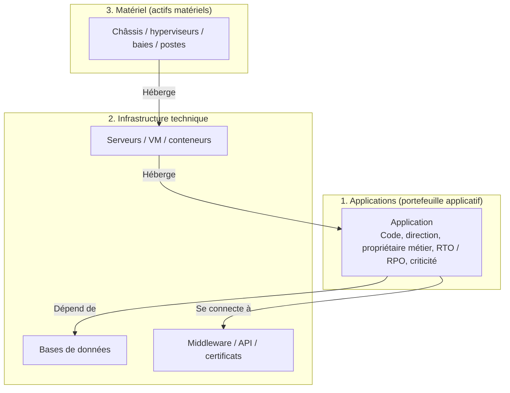
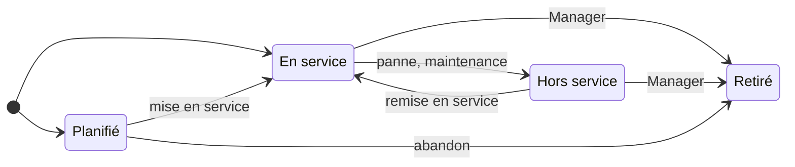
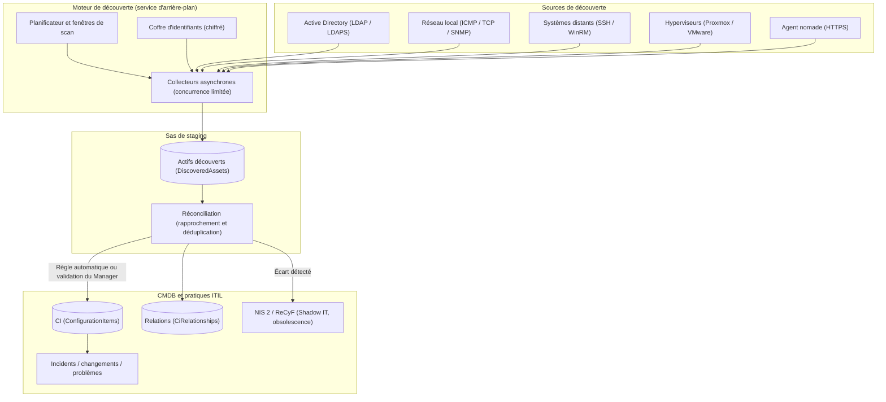
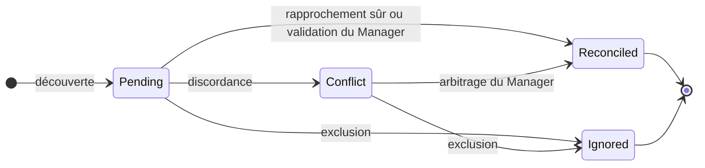

# 🧩 Gestion de la configuration

> Pratique ITIL 4 *Service configuration management*. Code :
> `backend/Modules/ServiceConfigurationManagement`,
> `frontend/src/modules/service-configuration-management`. Préfixe des règles : **CFG**.
> Socle commun et conventions (✅ / 🔜, lots) : [règles métier](../regles-metier.md).

[← Règles métier](../regles-metier.md) · [Toutes les pratiques](readme.md)

## 1. Objectif et périmètre

*Objectif ITIL 4 : s'assurer que des informations exactes et fiables sur la configuration
des services, et sur les éléments de configuration qui les supportent, sont disponibles
quand et où elles sont nécessaires.*

Un **élément de configuration (CI)** est tout composant à gérer pour fournir un service :
application, serveur, base de données, équipement réseau… La base des CI et de leurs
**relations** (CMDB) sert l'analyse d'impact des incidents et des changements. Elle est
alimentée de façon hybride : saisie manuelle et découverte automatique du réseau, qui passe
par un sas de staging (§ 4.2, chantier F13 du [plan d'action](../../plan-action.md)).

La plateforme y tient deux référentiels, qui reprennent le volet configuration de deux
autres pratiques ITIL 4 (§ 3.1) :

- le **portefeuille applicatif** (*application portfolio*, pratique ITIL 4 *Portfolio
  management*) : l'inventaire des applications, de leur gouvernance et de leur cycle de vie ;
- les **actifs matériels** (pratique ITIL 4 *IT asset management*) : l'inventaire du
  matériel physique, de son identification et de son cycle de vie.

Hors périmètre : le volet financier de la gestion des actifs (coûts, contrats, amortissements)
et l'arbitrage du portefeuille (choix d'investissement entre applications ou projets).

## 2. Rôles et droits

| Rôle ITIL | Rôle applicatif | Responsabilités |
|---|---|---|
| Gestionnaire de la configuration | Manager | Garant de l'exactitude de la CMDB, vérifications, retraits, scans et réconciliation du staging |
| Propriétaire de CI | Responsable AD du CI | Tient la fiche à jour, la vérifie |
| Contributeur | User | Crée et met à jour les CI et relations |
| Administrateur | Admin | Droits du Manager, suppression, import, coffre d'identifiants |

| Action | User | Manager | Admin | Statut |
|---|---|---|---|---|
| Créer, modifier un CI, gérer ses relations | ✔ | ✔ | ✔ | ✅ |
| Passer un CI à **Retiré** | ✘ | ✔ | ✔ | ✅ CFG-12 |
| Enregistrer une vérification | Propriétaire | ✔ | ✔ | ✅ CFG-15 |
| Consulter le sas de staging | ✘ | ✔ | ✔ | 🔜 CFG-40 |
| Réconcilier, ignorer ou supprimer un actif du staging | ✘ | ✔ | ✔ | 🔜 CFG-40 |
| Créer, modifier, déclencher une tâche de scan | ✘ | ✔ | ✔ | 🔜 CFG-46 |
| Supprimer une tâche de scan | ✘ | ✘ | ✔ | 🔜 |
| Gérer le coffre d'identifiants | ✘ | ✘ | ✔ | 🔜 CFG-45 |
| Importer en masse | ✘ | ✘ | ✔ | 🔜 CFG-30 |
| Supprimer un CI | ✘ | ✘ | ✔ | ✅ |

Les actifs découverts, tâches de scan et identifiants portent un périmètre, comme les CI :
un Manager ne voit et ne traite que ceux de ses périmètres ([périmètres](../perimetres.md)).

## 3. Données

Champs communs (référence `CI-AAAA-NNNN`, nom = titre, description, statut, propriétaire
AD, créateur, dates) : [socle](../regles-metier.md#5-règles-communes-aux-processus).

### 3.1. Modèle à trois couches

Pour qu'une CMDB reste lisible à grande échelle (portefeuille de plus de 1 000
applications), les CI se rangent en trois couches, reliées par les relations du § 3.2 :

1. **Applications (portefeuille applicatif, § 3.3)** : applications logiques, code
   applicatif, direction utilisatrice, duo de gouvernance, criticité, RTO / RPO, NIS 2.
2. **Infrastructure technique** : serveurs, VM, conteneurs, bases de données, middleware et
   API, reliés aux applications par *Héberge*, *Dépend de* et *Se connecte à*.
3. **Matériel (actifs matériels, § 3.4)** : châssis, serveurs physiques, commutateurs,
   baies, postes ; constructeur, numéro de série, garantie, emplacement.

Les flèches suivent le sens des relations (source → cible) ; la propagation d'une panne
suit CFG-05.

### 3.2. Socle commun du CI (`ConfigurationItem`)

| Champ | Type | Oblig. | Valeurs / règle | Statut |
|---|---|---|---|---|
| `CiType` | texte 30 | ✔ | Application, Serveur, Base de données, Réseau, Stockage, Poste de travail, Logiciel, Autre | ✅ |
| `Environment` | texte 20 | ✔ | Production, Recette, Développement, Autre | ✅ |
| `Location` | texte 150 | | Emplacement ; pour le matériel physique : Site > Bâtiment > Salle > Baie > U (CFG-44) | ✅ |
| `Status` | texte 30 | ✔ | Planifié, En service, Hors service, Retiré ; choisi à la création (défaut En service) | ✅ |
| `Owner…` | AD | En service | Propriétaire du CI (CFG-11) | ✅ |
| `Attributes` | clé/valeur | | Attributs propres au type (version, adresse IP, adresse MAC, éditeur…) | 🔜 CFG-16 |
| `LastVerifiedAt`, `LastVerifiedBy` | date, AD | auto | Dernière vérification | ✅ CFG-15 |
| Services supportés | liens CI ↔ service | | Les services du catalogue reliés au CI (onglet Liens) | ✅ CFG-21 |

**Relation** (`CiRelationships`) : source, cible, type orienté — *Dépend de*, *Héberge*,
*Fait partie de*, *Se connecte à*. ✅

### 3.3. Portefeuille applicatif (`CiType` = Application)

Champs de gouvernance des applications, en colonnes dédiées (CFG-43, CFG-48).
« En service » : obligatoires pour un CI En service ou Hors service, comme le propriétaire
(CFG-11) ; un CI Planifié peut s'en passer.

| Champ | Type | Oblig. | Valeurs / règle | Statut |
|---|---|---|---|---|
| `AppCode` | texte 20 | En service | Code applicatif unique parmi les CI non retirés (ex. `FIN` ou `APP-FIN-001`) | 🔜 CFG-43 |
| `BusinessUnit` | texte 100 | En service | Direction métier utilisatrice (ex. Direction financière, RH) | 🔜 CFG-43 |
| `BusinessOwner…` | AD | En service | Propriétaire métier (Product Owner / MOA) | 🔜 CFG-43 |
| `TechnicalOwner…` | AD | En service | Responsable technique DSI (Tech Lead / TMA / exploitation) ; peut être le propriétaire du CI | 🔜 CFG-43 |
| `Criticality` | texte 10 | En service | Vitale, Majeure, Standard, Mineure | 🔜 CFG-43 |
| `RtoHours`, `RpoHours` | entier | | RTO (durée maximale d'interruption) et RPO (perte de données admissible), en heures | 🔜 |
| `GdprSensitive` | booléen | | Traitement de données personnelles ou sensibles au sens du RGPD | 🔜 |
| `Nis2Scope` | booléen | | Application du périmètre NIS 2 de l'organisation ; la catégorie d'entité (essentielle, importante) relève de l'[évaluation de conformité](conformite-nis2.md) (NIS-01) | 🔜 |
| `AppLifecycle` | texte 30 | ✔ | Étude, Développement, Homologation, En production, Dépréciée, Retirée ; cohérent avec `Status` (§ 4.3, CFG-48) | 🔜 CFG-48 |

### 3.4. Actifs matériels (types Réseau, Stockage, Poste de travail ; Serveur physique)

Champs d'identification et de cycle de vie du matériel, en colonnes dédiées (CFG-44). Le numéro de série n'est exigé que
pour les types Réseau, Stockage et Poste de travail : un CI Serveur peut être une VM.

| Champ | Type | Oblig. | Valeurs / règle | Statut |
|---|---|---|---|---|
| `Vendor` | texte 100 | En service | Constructeur (ex. Cisco, Dell, HP, Fortinet, Synology) | 🔜 CFG-44 |
| `Model` | texte 100 | | Modèle commercial et référence constructeur | 🔜 |
| `SerialNumber` | texte 100 | En service | Numéro de série ou étiquette d'inventaire, unique parmi les CI non retirés ; premier critère de rapprochement (CFG-41) | 🔜 CFG-44 |
| `PurchaseDate` | date | | Date d'acquisition | 🔜 |
| `WarrantyExpiry` | date | | Fin de garantie constructeur | 🔜 |
| `EndOfSupport` | date | | Fin de support constructeur (EOL / EOS, CFG-47) | 🔜 |

L'emplacement physique précis se saisit dans `Location` (§ 3.2).

### 3.5. Découverte et sas de staging

| Objet | Champs principaux | Usage | Statut |
|---|---|---|---|
| Actif découvert (`DiscoveredAssets`) | `IPAddress`, `MacAddress`, `Hostname`, `SerialNumber`, `Vendor`, `Model`, `DetectedOs`, `DetectedType` (valeurs de `CiType`), `OpenPorts`, `RawDataJson`, `Source` (IpSweep, ActiveDirectory, Snmp, Ssh, WinRm, Agent), `Status` (Pending, Reconciled, Ignored, Conflict), `ConfidenceScore` (0 à 100), `MatchedCiId`, `JobId`, `FirstSeenAt`, `LastSeenAt`, `ReconciledAt`, `ReconciledBy`, périmètre | Sas de staging avant réconciliation (CFG-40) | 🔜 |
| Tâche de scan (`DiscoveryJobs`) | `Name`, `TargetRange` (CIDR, IP ou BaseDN), `ScanType` (IpSweep, ActiveDirectory, Snmp, Ssh, WinRm), `ScheduleCron`, `PortList`, `CredentialId`, `IsActive`, `LastRunAt`, `LastStatus` (Idle, Running, Success, Failed), `LastErrorMessage`, périmètre | Planification et suivi des scans (CFG-46) | 🔜 |
| Coffre d'identifiants (`DiscoveryCredentials`) | `Name`, `CredentialType` (SnmpV2c, SnmpV3, SshKey, WindowsDomain, CloudApi), `Username`, `Domain`, `EncryptedSecret`, périmètre | Secrets chiffrés au repos, jamais renvoyés (CFG-45) | 🔜 |

## 4. Cycle de vie

### 4.1. CI

Statut choisi à la création ; seules les transitions ci-dessous sont permises (CFG-10,
SOC-05). Les cycles du portefeuille applicatif et des actifs matériels (§ 4.3, § 4.4) se lisent sur
ces mêmes statuts.

| De → Vers | Qui | Conditions (400 sinon) | Effets | Statut |
|---|---|---|---|---|
| — → Planifié ou En service | Tous | Nom, type, environnement ; En service : propriétaire (CFG-11) | Référence | ✅ |
| Planifié → En service | Tous | Propriétaire renseigné (CFG-11) ; champs « En service » des § 3.3 et 3.4 | | ✅ (§ 3.3, 3.4 : 🔜) |
| En service ⇄ Hors service | Tous | | | ✅ |
| En service, Hors service, Planifié → Retiré | Manager | Aucun incident ni changement ouvert relié (CFG-13) | Relations conservées (historique), CI exclu des nouveaux liens (CFG-14) | ✅ CFG-12 |
| Retiré → … | — | Statut final | | ✅ CFG-10 |

### 4.2. Découverte et sas de staging

Le moteur de découverte est un service d'arrière-plan de l'API, asynchrone et non intrusif
(concurrence limitée, CFG-46), qui puise ses secrets dans le coffre d'identifiants
(CFG-45). Aucune donnée découverte n'entre directement dans la CMDB : chaque actif
transite par le sas de **staging** (`DiscoveredAssets`), où le moteur de réconciliation le
rapproche des CI existants (CFG-41).

Collecteurs, par phase du chantier F13 : annuaire AD (phase 1), balayage IP et SNMP
(phase 2), SSH, WinRM et hyperviseurs (phase 3), agent nomade (phase 4).

| De → Vers | Qui | Conditions | Effets | Statut |
|---|---|---|---|---|
| — → Pending | Système | Détection par scan IP, annuaire AD, SNMP, SSH, WinRM ou agent | Actif créé avec son score de rapprochement (CFG-41) ; un actif déjà présent (même IP ou même nom d'hôte) est mis à jour (`LastSeenAt`, ports, OS), pas dupliqué | 🔜 CFG-40 |
| Pending → Reconciled | Système | Score ≥ 80 (série, MAC ou nom d'hôte) | Mise à jour du CI rapproché ; jamais de création automatique | 🔜 CFG-41 |
| Pending → Reconciled | Manager | Validation dans la console de staging | Mise à jour du CI choisi, ou création d'un CI soumise aux règles du CI (CFG-11, CFG-17, CFG-43, CFG-44) | 🔜 CFG-40 |
| Pending → Conflict | Système | Rapprochement par la seule IP (score 50), ou critères contradictoires (même IP, numéro de série différent) | Signalé dans le tableau de réconciliation | 🔜 CFG-41 |
| Conflict → Reconciled | Manager | Arbitrage sur le CI cible | Mise à jour ou création du CI, comme ci-dessus | 🔜 CFG-40 |
| Pending, Conflict → Ignored | Manager | Équipement personnel, invité ou hors CMDB | Actif conservé, plus proposé à la réconciliation | 🔜 CFG-40 |

### 4.3. Portefeuille applicatif

Une application traverse un cycle de gouvernance plus long qu'une machine. Il est porté
par `AppLifecycle`, qui reste cohérent avec le statut du CI (CFG-48) :

```mermaid
stateDiagram-v2
    direction LR
    [*] --> Etude : cadrage
    Etude --> Developpement : projet validé
    Developpement --> Homologation : recette métier
    Homologation --> EnProduction : mise en production
    EnProduction --> Depreciee : remplacement planifié
    Depreciee --> Retiree : décommissionnement
    Retiree --> [*]
    Etude : Étude
    Developpement : Développement
    EnProduction : En production
    Depreciee : Dépréciée
    Retiree : Retirée
```

| `AppLifecycle` | Statut du CI | Rôle dans la DSI | Usage attendu |
|---|---|---|---|
| **Étude** | Planifié | Projet en cadrage, rattachement budgétaire | Relié aux projets |
| **Développement** | Planifié | Application en construction | Relié aux projets |
| **Homologation** | Planifié | Recette fonctionnelle, tests d'acceptation | Changements de pré-production |
| **En production** | En service ou Hors service | Application active | Incidents, changements, problèmes, SLA |
| **Dépréciée** | En service ou Hors service | Maintenue, appelée à être remplacée | Incidents ; pas de nouveau projet |
| **Retirée** | Retiré | Arrêtée et archivée | Aucun nouveau lien (CFG-14) |

Seul le dernier usage est contrôlé (CFG-14) ; les autres sont indicatifs.

### 4.4. Actifs matériels

Les équipements physiques suivent le cycle du CI (§ 4.1), lu en étapes du cycle de vie
d'un actif :

| Étape de l'actif | Statut du CI |
|---|---|
| Réception, en stock | Planifié |
| Déployé, brassé | En service |
| En panne, en maintenance | Hors service |
| Réformé (DEEE, obsolescence, panne irréversible) | Retiré |

## 5. Règles de gestion

| ID | Règle | Statut | Lot |
|---|---|---|---|
| CFG-01 | Un CI porte un nom, un type, un environnement, un emplacement et un propriétaire ; statut choisi à la création (« En service » par défaut) | ✅ | |
| CFG-02 | **Relations** orientées entre CI (*Dépend de*, *Héberge*, *Fait partie de*, *Se connecte à*) ; la fiche montre les relations sortantes et entrantes | ✅ | |
| CFG-03 | Pas de relation d'un CI vers lui-même (400), ni de doublon même source, cible et type (409) | ✅ | |
| CFG-04 | **Vue d'impact** transitive : **en aval**, les CI touchés si ce CI tombe ; **en amont**, ceux dont il dépend | ✅ | |
| CFG-05 | **Sens de propagation** d'une panne : « A *dépend de* / *se connecte à* B » — la panne de B touche A ; « A *héberge* / *fait partie de* B » — la panne de A touche B | ✅ | |
| CFG-06 | Dans la vue d'impact, chaque CI n'apparaît qu'une fois, à sa plus courte distance, avec la relation par laquelle il est atteint ; un cycle ne boucle pas | ✅ | |
| CFG-07 | Registre filtrable par type (`type`), statut et texte | ✅ | |
| CFG-10 | **Transitions contraintes** selon le § 4.1 (SOC-05) ; Retiré est final | ✅ | 1 |
| CFG-11 | Le **propriétaire** est obligatoire pour un CI En service | ✅ | 1 |
| CFG-12 | **Retirer** un CI : Manager uniquement | ✅ | 1 |
| CFG-13 | Un CI relié à un **incident ou changement ouvert** ne peut pas être retiré (400, avec les références en cause) | ✅ | 1 |
| CFG-14 | Un CI **Retiré** ne peut plus être relié à un nouvel incident, changement ou CI (400) ; ses liens existants restent visibles | ✅ | 1 |
| CFG-15 | **Vérification** : le propriétaire ou un Manager atteste que la fiche est exacte (`LastVerifiedAt`) ; un CI En service non vérifié depuis **12 mois** remonte en relance au propriétaire. Vérification par `POST /api/configuration-items/{id}/verify` ; relance par notification (relevé périodique). | ✅ | |
| CFG-16 | **Attributs par type** : chaque type de CI définit des attributs facultatifs (Serveur : système, adresse IP, adresse MAC, CPU, mémoire ; Application : version, éditeur, URL ; Poste de travail : utilisateur…). Les champs du portefeuille applicatif et des actifs matériels (§ 3.3, § 3.4) sont des colonnes dédiées, hors de ces attributs | 🔜 | 3 |
| CFG-17 | **Unicité** : deux CI non retirés ne peuvent pas avoir le même nom dans le même environnement (409) | ✅ | 1 |
| CFG-18 | Un CI **Hors service** relié à un service En service signale ce service « dégradé » sur la fiche du service | 🔜 | 2 |

Règles du chantier F13 (découverte automatique et CMDB augmentée, [plan
d'action](../../plan-action.md#découverte-automatique-et-cmdb-augmentée-f13)) :

| ID | Règle | Statut | Lot |
|---|---|---|---|
| CFG-40 | **Sas de staging obligatoire** : tout actif découvert entre dans `DiscoveredAssets` au statut Pending ; aucun CI n'est créé ni modifié par la découverte sans réconciliation (§ 4.2). Un CI créé depuis le staging respecte les règles du CI (CFG-11, CFG-17, CFG-43, CFG-44) | 🔜 | 3 |
| CFG-41 | **Rapprochement et déduplication** : un actif est comparé aux CI non retirés, dans l'ordre : 1. numéro de série (score 100), 2. adresse MAC (90), 3. nom d'hôte, court ou FQDN, comparé au nom du CI (80), 4. adresse IP (50) ; le premier critère qui aboutit l'emporte. Action suggérée : *UpdateExisting* (score ≥ 80), *Conflict* (IP seule), *CreateNew* (aucun rapprochement, validation du Manager requise) | 🔜 | 3 |
| CFG-42 | **Détection du Shadow IT** : un actif actif sur le réseau, sans compte d'ordinateur AD et sans CI rapproché, est signalé en anomalie « actif inconnu » | 🔜 | 3 |
| CFG-43 | **Portefeuille applicatif** : un CI Application En service ou Hors service porte un code applicatif unique (`AppCode`, 409 si doublon), une direction utilisatrice, une criticité et un duo de gouvernance (propriétaire métier et responsable DSI) ; 400 sinon | 🔜 | 3 |
| CFG-44 | **Actifs matériels** : un CI Réseau, Stockage ou Poste de travail En service ou Hors service porte un constructeur, un numéro de série unique (409 si doublon) et un emplacement physique (`Location`) ; 400 sinon | 🔜 | 3 |
| CFG-45 | **Coffre d'identifiants** : les secrets de scan (`DiscoveryCredentials`) sont chiffrés au repos (ASP.NET Data Protection, AES-256) et jamais renvoyés par l'API, qui indique seulement leur présence | 🔜 | 3 |
| CFG-46 | **Sobriété et fenêtres de scan** : les scans s'exécutent en tâche de fond, avec une concurrence limitée (10 hôtes sondés à la fois par défaut), une plage IP de /24 au plus large, et dans les fenêtres planifiées (`ScheduleCron`, hors heures ouvrées) ; un déclenchement manuel d'une tâche déjà en cours ⇒ 400 | 🔜 | 3 |
| CFG-47 | **Détection d'obsolescence (NIS 2)** : les versions d'OS et de firmware détectées sont comparées aux fins de vie (EOL / EOS) et aux dates `EndOfSupport` ; les écarts alimentent les preuves de l'objectif 6 du ReCyF | 🔜 | 3 |
| CFG-48 | **Cycle applicatif cohérent** : `AppLifecycle` Étude, Développement, Homologation ⇔ CI Planifié ; En production, Dépréciée ⇔ En service ou Hors service ; Retirée ⇔ Retiré (400 sinon, § 4.3) | 🔜 | 3 |

## 6. Délais, calculs et alertes

| ID | Règle | Statut | Lot |
|---|---|---|---|
| CFG-20 | **Analyse d'impact d'un changement** : la fiche d'un changement montre, pour ses CI, la vue d'impact aval et les services touchés (CFG-21). Onglet « Impact » de la fiche d'un changement : CI reliés, CI touchés en aval, services. | ✅ | |
| CFG-21 | **Rattachement CI ↔ service** (F5) : un CI supporte un ou plusieurs services du catalogue ; la vue d'impact aval d'un CI liste les services touchés. Un CI supporte les services auxquels il est relié ; la vue d'impact liste les services du CI et des CI en aval. | ✅ | |
| CFG-22 | Notifications (SOC-21) : CI passé Hors service → propriétaire et responsables des services touchés | ✅ | |

## 7. Liens avec les autres pratiques

| Lien | Sens | Règle | Statut |
|---|---|---|---|
| CI → CI | Dépendances entre applications, infrastructure et matériel (un serveur physique *héberge* une VM, qui *héberge* une application) | CFG-02 à CFG-06 | ✅ |
| CI → Service | Services supportés (lien CI ↔ service) | CFG-21 | ✅ |
| Incident → CI | CI affecté (application ou serveur) | CFG-14 | ✅ |
| Changement → CI | CI modifié ; conflits au calendrier ; analyse d'impact amont et aval | CHG-09, CFG-20 | ✅ |
| Problème → CI | CI en cause | Lien manuel | ✅ |
| Découverte → [Conformité NIS 2](conformite-nis2.md) | Preuves d'inventaire du ReCyF (objectifs 4, 5, 6) : Shadow IT, obsolescence | CFG-42, CFG-47 | 🔜 |
| Découverte → [Amélioration continue](amelioration-continue.md) | Proposition d'action corrective sur un actif obsolète ou non sécurisé | CFG-47 | 🔜 |

## 8. Console et indicateurs

Console : mes CI (Mon travail) ✅. À venir : CI à vérifier (Relances, CFG-15), CI Hors
service depuis plus de 7 jours (Relances, gestionnaires, lot 2), actifs en attente ou en
conflit dans le sas de staging (gestionnaires, CFG-40).

| Indicateur | Calcul | Statut |
|---|---|---|
| Volumétrie par statut | Nombre de CI par statut | ✅ |
| CI par type et environnement | Répartition par `CiType` et `Environment` | 🔜 CFG-31 (lot 2) |
| Exactitude de la CMDB | Part des CI En service vérifiés depuis moins de 12 mois | 🔜 CFG-32 (lot 2) |
| CI les plus impliqués | CI reliés au plus d'incidents sur la période | 🔜 CFG-33 (lot 2) |
| CI sans propriétaire ni relation | Qualité des données | 🔜 CFG-34 (lot 2) |
| Couverture du portefeuille applicatif | Part des applications En service avec leur duo de gouvernance (CFG-43) | 🔜 CFG-35 (lot 3) |
| Actifs en staging | Nombre d'actifs Pending et Conflict | 🔜 CFG-36 (lot 3) |
| Shadow IT | Nombre d'actifs inconnus détectés (CFG-42) | 🔜 CFG-37 (lot 3) |
| Obsolescence des actifs | Nombre de CI en fin de support (EOL / EOS, CFG-47) | 🔜 CFG-38 (lot 3) |

## 9. API

| Route | Policy | Rôle |
|---|---|---|
| `GET /api/configuration-items` (filtres `status`, `q`, `owner`, `type`), `GET /api/configuration-items/{id}` | User | Registre, fiche (relations) |
| `GET /api/configuration-items/{id}/impact` | User | Vue d'impact amont et aval, services touchés (CFG-21) |
| `GET /api/configuration-items/impact-of?type=&id=` | User | Impact d'un enregistrement (changement) : CI reliés, CI en aval, services (CFG-20) |
| `POST /api/configuration-items/{id}/verify` | User (propriétaire) ou Manager | Marque la fiche vérifiée (CFG-15) |
| `POST /api/configuration-items`, `PUT /api/configuration-items/{id}` | User | Création, modification |
| `POST /api/configuration-items/{id}/relations`, `DELETE /api/configuration-items/relations/{id}` | User | Relations |
| `DELETE /api/configuration-items/{id}` | Admin | Suppression |
| `POST /api/configuration-items/import` | Admin | Import CSV — 🔜 CFG-30 |
| `GET /api/discovery/staging` (filtres `status`, `source`, `q`), `GET …/staging/{id}` | Manager | Actifs du staging ; la fiche donne le rapprochement suggéré (CFG-41) — 🔜 |
| `POST …/staging/{id}/reconcile`, `POST …/staging/{id}/ignore`, `DELETE …/staging/{id}` | Manager | Réconciliation, exclusion, suppression (CFG-40) — 🔜 |
| `GET /api/discovery/jobs`, `GET …/jobs/{id}`, `POST …/jobs`, `PUT …/jobs/{id}`, `POST …/jobs/{id}/run` | Manager | Tâches de scan, déclenchement manuel (202, CFG-46) — 🔜 |
| `DELETE /api/discovery/jobs/{id}` | Admin | Suppression d'une tâche — 🔜 |
| `GET /api/discovery/credentials`, `POST …/credentials`, `DELETE …/credentials/{id}` | Admin | Coffre d'identifiants (CFG-45) — 🔜 |

| ID | Règle | Statut | Lot |
|---|---|---|---|
| CFG-30 | **Import en masse** (CSV : nom, type, environnement, emplacement, propriétaire, statut) : validation ligne à ligne, rapport des lignes refusées, aucun enregistrement partiel en cas d'erreur de format | 🔜 | 3 |

## 10. Scénarios d'acceptation

- **CFG-03** — *Quand* on relie un CI à lui-même, *alors* 400 ; une relation identique déjà présente, 409.
- **CFG-05** — *Étant donné* `SRV-MAIL-01` *dépend de* `FW-SIEGE-01`, *alors* la vue aval de `FW-SIEGE-01` contient `SRV-MAIL-01`, et la vue amont de `SRV-MAIL-01` contient `FW-SIEGE-01`.
- **CFG-06** — *Étant donné* A dépend de B et B dépend de A, *alors* la vue d'impact de A se termine et liste B une seule fois.
- **CFG-13** — *Étant donné* un CI relié à un incident En cours, *quand* un Manager le retire, *alors* 400 qui cite l'incident.
- **CFG-14** — *Étant donné* un CI Retiré, *quand* on le relie à un nouveau changement, *alors* 400.
- **CFG-17** — *Étant donné* un CI `SRV-MAIL-01` en Production, *quand* on en crée un second du même nom en Production, *alors* 409 ; en Recette, accepté.
- **CFG-40** — *Étant donné* un actif découvert par un scan réseau, *quand* le scan se termine, *alors* l'actif est au statut Pending dans `DiscoveredAssets` et aucun CI n'a été créé ; un second scan qui le retrouve met à jour `LastSeenAt` sans le dupliquer.
- **CFG-41** — *Étant donné* un actif en staging de numéro de série `SN-48291`, égal à celui d'un CI existant, *quand* le rapprochement est calculé, *alors* le score vaut 100 et l'action suggérée est *UpdateExisting* ; rapproché par sa seule IP, score 50 et *Conflict*.
- **CFG-42** — *Étant donné* une machine qui répond au ping et a des ports ouverts, absente d'Active Directory et sans CI rapproché, *alors* elle est signalée en actif inconnu.
- **CFG-43** — *Quand* on crée un CI Application En service sans code applicatif ou sans propriétaire métier, *alors* 400 ; Planifié, accepté.
- **CFG-45** — *Étant donné* un identifiant enregistré dans le coffre, *quand* un Admin liste le coffre, *alors* la réponse ne contient pas le secret, seulement son existence ; un Manager ⇒ 403.
