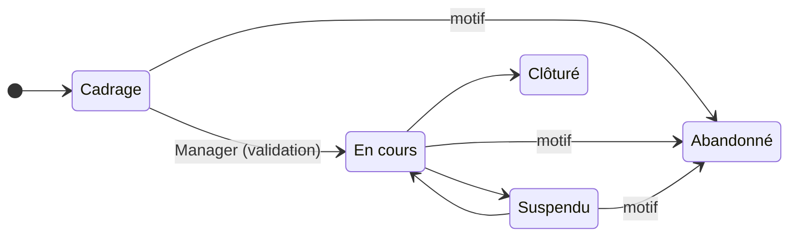

# 📐 Gestion de projet

> Pratique ITIL 4 de gestion générale *Project management*. Code :
> `backend/Modules/ProjectManagement`, `frontend/src/modules/project-management`. Préfixe des
> règles : **PRJ**. Socle commun et conventions (✅ / 🔜, lots) :
> [règles métier](../regles-metier.md). La méthode active des composants :
> [ADR-0015](../../decisions/adr-0015-gestion-de-projet-methode-active-composants.md).

[← Règles métier](../regles-metier.md) · [Toutes les pratiques](readme.md)

## 1. Objectif et périmètre

*Objectif ITIL 4 (gestion de projet) : s'assurer que tous les projets de l'organisation
aboutissent, en planifiant, déléguant, suivant et maintenant le contrôle de tous leurs
aspects, et en motivant les personnes qui y participent.*

Un **projet** a un début, une fin, un chef de projet, un budget et une méthode. La DSI y
conduit ce qui dépasse un changement : migration, refonte, déploiement d'un nouveau service,
mise en conformité. La **méthode** choisie à la création (Scrum, Kanban, Cycle en V,
PRINCE2 ou Hybride) **active les composants** dont le projet a besoin — backlog, sprints,
phases, jalons, risques… — et seulement ceux-là : la fiche d'un projet Kanban n'affiche ni
sprint ni burndown.

Le projet est relié aux pratiques ITIL qu'il touche : **changements** qu'il fait passer en
production, **problèmes** qu'il corrige, **améliorations** qu'il réalise, **CI** et
**services** qu'il crée ou modifie.

Hors périmètre : la gestion de portefeuille (arbitrage entre projets), la saisie des temps,
la gestion des ressources et de leur charge, le diagramme de Gantt interactif.

## 2. Rôles et droits

| Rôle | Rôle applicatif | Responsabilités |
|---|---|---|
| Chef de projet | Responsable AD du projet (`Owner`, compte utilisateur) | Crée et cadre le projet, choisit la méthode, planifie, valide livrables et fins d'étape |
| Équipe projet | Tous | Tient le backlog et le tableau, fait avancer les livrables, déclare risques et incidents projet |
| Gestionnaire | Manager | Valide le projet au sortir du cadrage ; mêmes droits que le chef de projet, sur tous les projets |

| Action | User | Chef de projet | Manager | Admin | Statut |
|---|---|---|---|---|---|
| Créer un projet (sans chef désigné, le créateur le devient) | ✔ | — | ✔ | ✔ | ✅ PRJ-01 |
| Valider le projet (Cadrage → En cours) | ✘ | ✘ | ✔ | ✔ | ✅ PRJ-08 |
| Modifier le projet, sa méthode, ses phases ou étapes, jalons et sprints | ✘ | ✔ | ✔ | ✔ | ✅ PRJ-02, PRJ-04 |
| Valider un livrable, valider une fin d'étape PRINCE2 | ✘ | ✔ | ✔ | ✔ | ✅ PRJ-11, PRJ-21 |
| Créer et déplacer éléments de travail ; livrables jusqu'à Livré ; risques, incidents projet | ✔ | ✔ | ✔ | ✔ | ✅ PRJ-11, PRJ-14, PRJ-15 |
| Supprimer un objet du projet | ✘ | ✔ | ✔ | ✔ | ✅ PRJ-04 |
| Supprimer un projet | ✘ | ✘ | ✘ | ✔ | ✅ PRJ-04 |

À la création, chacun peut désigner un autre chef de projet ; ensuite, seuls le chef de
projet ou un gestionnaire modifient le projet. Le chef de projet **ne valide pas son propre
projet** : le passage en exécution est une décision de gestionnaire (PRJ-08).

## 3. Données

Champs communs (référence `PRJ-AAAA-NNNN`, titre, description, statut, responsable AD =
chef de projet, créateur, dates) : [socle](../regles-metier.md#5-règles-communes-aux-processus).
Type de lien : `project`.

### Projet

| Champ | Type | Oblig. | Valeurs / règle | Statut |
|---|---|---|---|---|
| `Method` | texte | ✔ | Scrum, Kanban, Cycle en V, PRINCE2, Hybride | ✅ PRJ-02 |
| `Components` | liste | auto / Hybride | Composants actifs (§ Composants) | ✅ PRJ-03 |
| `StartDate`, `TargetEndDate` | date | à la validation | Exigées pour passer En cours | ✅ PRJ-08 |
| `Budget`, `ActualCost` | décimal | | Budget et coût réel (tolérance de coût) | ✅ PRJ-32 |
| `ValidatedBy`, `ValidatedAt` | texte, date | auto | Validation par un gestionnaire | ✅ PRJ-08 |
| `AbandonReason` | texte | à l'abandon | Motif | ✅ PRJ-09 |

### Composants

La méthode fixe les composants (PRJ-03) ; seul un projet **Hybride** les choisit. Un
composant désactivé garde ses données, masquées ; créer un objet d'un composant inactif ⇒
400 « Composant non activé pour ce projet ».

| Composant | Scrum | Kanban | Cycle en V | PRINCE2 | Hybride (défaut) |
|---|---|---|---|---|---|
| Backlog (éléments de travail) | ✔ | ✔ | | | ✔ |
| Sprints | ✔ | | | | ✔ |
| Tableau | ✔ | ✔ | | | ✔ |
| Burndown | ✔ | | | | ✔ |
| Phases | | | ✔ | | ✔ |
| Étapes de gestion | | | | ✔ | |
| Jalons | | | ✔ | | ✔ |
| Livrables | | | ✔ | | ✔ |
| Risques | | | | ✔ | ✔ |
| Incidents projet | | | | ✔ | |
| Business case | | | | ✔ | |
| Tolérances | | | | ✔ | |

### Objets du projet

| Objet | Champs | Statuts | Règle |
|---|---|---|---|
| **Phase** (Cycle en V) | Nom, ordre, dates | À venir → En cours → Terminée, librement (chef de projet, Manager) | PRJ-10 |
| **Étape** (PRINCE2) | Nom, ordre, dates, `ApprovedBy`, `ApprovedAt` | À venir → En cours → Terminée ; Terminée seulement par la validation de fin d'étape | PRJ-20, PRJ-21 |
| **Jalon** | Nom, échéance, atteint le | En retard si l'échéance est passée sans être atteint | PRJ-30 |
| **Livrable** | Nom, `ValidatedBy`, `ValidatedAt` | À produire → En cours → Livré → Validé | PRJ-11 |
| **Élément de travail** | Type (User story, Tâche, Bogue), titre, points (0 à 100), critères d'acceptation, rang au backlog, sprint, `CompletedAt` | À faire → En cours → En revue → Terminé | PRJ-14 |
| **Sprint** | Objectif, début, fin | Planifié → Actif → Clos | PRJ-12 |
| **Risque** | Probabilité 1–5, impact 1–5, criticité = P × I, réponse (Éviter, Réduire, Transférer, Accepter, Partager), propriétaire | Ouvert, Clos | PRJ-15 |
| **Incident projet** | Type (Demande de changement, Hors spécification, Problème ou préoccupation), gravité, résolution | Ouvert, Clos | PRJ-15 |
| **Business case** | Justification, bénéfices attendus, coûts, délais, principaux risques | — | PRJ-06 |
| **Tolérances** | Délai (jours), coût (%), périmètre et qualité (texte) | — | PRJ-31, PRJ-32 |

Un **incident projet** (PRINCE2 : *issue*) n'est pas un incident ITIL : il porte sur le
projet (demande de changement de périmètre, écart à la spécification), pas sur un service
en production.

## 4. Cycle de vie

| De → Vers | Qui | Conditions (400 sinon) | Effets | Statut |
|---|---|---|---|---|
| — → Cadrage | Tous | Titre, méthode | Référence ; composants de la méthode ; phases (V) ou étapes (PRINCE2) proposées | ✅ PRJ-01, PRJ-10, PRJ-20 |
| Cadrage → En cours | Manager, Admin (403 pour le chef de projet) | Chef de projet désigné, début et fin cible ; business case justifié si le composant est actif | `ValidatedAt`, `ValidatedBy` | ✅ PRJ-06, PRJ-08 |
| En cours ↔ Suspendu | Chef de projet, Manager | Pas de nouvelle validation au retour | | ✅ PRJ-05 |
| En cours → Clôturé | Chef de projet, Manager | | | ✅ PRJ-05 |
| Cadrage, En cours, Suspendu → Abandonné | Chef de projet, Manager | Motif | | ✅ PRJ-09 |
| Clôturé, Abandonné → … | — | Statuts finaux ; les objets du projet sont figés | | ✅ PRJ-05, PRJ-07 |

## 5. Règles de gestion

| ID | Règle | Statut | Lot |
|---|---|---|---|
| PRJ-01 | Tout rôle crée un projet ; sans chef de projet désigné, le créateur le devient (`Owner`) | ✅ | |
| PRJ-02 | La **méthode** (Scrum, Kanban, Cycle en V, PRINCE2, Hybride) se choisit à la création et se change par le chef de projet ou un gestionnaire | ✅ | |
| PRJ-03 | La méthode **fixe les composants** (§ 3) ; seul un projet Hybride les choisit, à défaut il reçoit la sélection par défaut. Objet d'un composant inactif ⇒ 400 ; données d'un composant désactivé conservées, masquées | ✅ | |
| PRJ-04 | Le projet, sa méthode, ses phases ou étapes, jalons et sprints se modifient par le **chef de projet** ou un **gestionnaire** (403 sinon) ; même règle pour supprimer un objet du projet ; supprimer un projet : Admin | ✅ | |
| PRJ-05 | **Transitions contraintes** selon le § 4 (SOC-05) ; Clôturé et Abandonné sont finaux | ✅ | |
| PRJ-06 | Pas de lancement (En cours) sans **business case justifié** quand le composant est actif | ✅ | |
| PRJ-07 | Projet Clôturé ou Abandonné : ses objets **ne se modifient plus** (400) | ✅ | |
| PRJ-08 | **Validation** : Cadrage → En cours par un gestionnaire seulement (403 pour le chef de projet, même sur son projet) ; exige chef de projet, début et fin cible ; pose `ValidatedAt`, `ValidatedBy`. Suspendu → En cours ne redemande pas de validation | ✅ | |
| PRJ-09 | **Abandon** motivé (`AbandonReason`) | ✅ | |
| PRJ-10 | Projet en **Cycle en V** : 8 phases proposées à la création, modifiables (Spécifications, Conception générale, Conception détaillée, Développement, Tests unitaires, Tests d'intégration, Recette, Mise en production) | ✅ | |
| PRJ-11 | **Livrables** : À produire → En cours → Livré → Validé ; seuls le chef de projet ou un gestionnaire valident (`ValidatedBy`, `ValidatedAt`) | ✅ | |
| PRJ-12 | **Sprints** : Planifié → Actif → Clos ; un seul Actif à la fois ; un sprint Actif a des dates ; le clore renvoie au backlog ses éléments non terminés ; un sprint Clos ne se rouvre pas et ne reçoit plus rien | ✅ | |
| PRJ-13 | **Burndown** du sprint : points restants à la fin de chaque jour et ligne idéale, calculés depuis les dates d'achèvement | ✅ | |
| PRJ-14 | **Éléments de travail** (User story, Tâche, Bogue) : créés et déplacés par tous ; points 0 à 100 ; rang au backlog (un nouvel élément va en fin) ; `CompletedAt` posé à l'entrée dans Terminé, effacé à la sortie | ✅ | |
| PRJ-15 | **Registre des risques** (criticité = probabilité × impact, critique à 15 et plus) et **registre des incidents projet** (clôture avec résolution), ouverts à tous | ✅ | |
| PRJ-20 | Projet **PRINCE2** : étapes Démarrage, Initialisation, Livraison 1, Clôture proposées à la création | ✅ | |
| PRJ-21 | Une **étape** ne passe à Terminée que par la **validation de fin d'étape** (chef de projet ou gestionnaire), qui pose `ApprovedBy`, `ApprovedAt` et ouvre l'étape suivante | ✅ | |
| PRJ-22 | **Prévision** de la date de fin (vélocité, avancement des phases) pour la tolérance de délai | ✅ (`ProjectHealth.ForecastEnd` : vélocité des sprints clos, sinon fin planifiée de la dernière phase non terminée décalée du retard de la phase en cours, sinon avancement depuis le début ; comparée à la fin cible et à la tolérance de délai ; indicateur « Fin prévue » de la synthèse) | |

## 6. Synthèse, calculs et alertes

Synthèse du projet : `GET /api/projects/{id}/summary`.

| ID | Règle | Statut | Lot |
|---|---|---|---|
| PRJ-30 | **Avancement** par composant : éléments et points, phases, livrables, jalons dont ceux **en retard** (échéance passée, non atteints) | ✅ | |
| PRJ-31 | **Tolérance de délai**, à la date du jour : *Dans la cible* jusqu'à la fin cible, *À surveiller* jusqu'à fin cible + tolérance en jours, puis *Hors tolérance* ; *Sans objet* si une donnée manque ou si le projet est clos | ✅ | |
| PRJ-32 | **Tolérance de coût** : *Dans la cible* si coût réel ≤ budget, *À surveiller* jusqu'à budget × (1 + tolérance %), puis *Hors tolérance* ; *Sans objet* comme PRJ-31 | ✅ | |
| PRJ-33 | Risques ouverts, risques **critiques**, incidents projet ouverts | ✅ | |
| PRJ-34 | Console : projets hors tolérance et jalons en retard (Relances, chef de projet et gestionnaires) ; projets à valider (Décisions) ; mes projets (Mon travail) | ✅ | |

## 7. Liens avec les autres pratiques

| Lien | Sens | Règle | Statut |
|---|---|---|---|
| Projet → Changement | Mises en production du projet | Lien manuel (SOC-12) | ✅ |
| Projet → Problème | Problème corrigé par le projet | Lien manuel | ✅ |
| Projet → Amélioration | Amélioration réalisée par le projet | Lien manuel | ✅ |
| Projet → CI, Service | CI et services créés ou modifiés | Lien manuel | ✅ |

## 8. Console et indicateurs

Console ✅ (PRJ-34) : projets en cadrage à valider (Décisions, gestionnaires) ; projets hors
tolérance — délai, coût ou fin prévue — ou à jalons en retard (Relances : gestionnaires ; le
chef de projet dans Mon travail) ; mes projets (Mon travail). Indicateurs du projet : synthèse
PRJ-22, PRJ-30 à PRJ-33.

| Indicateur | Calcul | Statut |
|---|---|---|
| Volumétrie par statut et par méthode | | 🔜 |
| Projets hors tolérance | PRJ-31, PRJ-32 | 🔜 (reporting) |

## 9. API

| Route | Policy | Rôle |
|---|---|---|
| `GET /api/projects` (filtres `status`, `q`, `owner`), `GET /api/projects/{id}` | User | Registre, fiche |
| `POST /api/projects` | User | Création (PRJ-01) |
| `PUT /api/projects/{id}` | Chef de projet, Manager ; Cadrage → En cours : Manager | En-tête, méthode, composants, business case, tolérances, transitions |
| `DELETE /api/projects/{id}` | Admin | Suppression |
| `GET /api/projects/{id}/summary` | User | Synthèse (PRJ-30 à PRJ-33) et prévision de fin (`forecast` : date, méthode, base, tolérance — PRJ-22) |
| `…/{id}/phases`, `…/milestones`, `…/sprints` (GET, POST, PUT, DELETE) | Lecture : User ; écriture : chef de projet, Manager | Phases ou étapes, jalons, sprints |
| `POST …/{id}/phases/{phaseId}/approve` | Chef de projet, Manager | Validation de fin d'étape (PRJ-21) |
| `GET …/{id}/sprints/{sprintId}/burndown` | User | Burndown : total, puis par jour la ligne idéale et les points restants (PRJ-13) |
| `…/{id}/deliverables` | User ; Validé : chef de projet, Manager | Livrables (PRJ-11) |
| `…/{id}/workitems`, `…/risks`, `…/issues` | User | Éléments de travail, risques, incidents projet |

Les objets d'un projet se suppriment par le chef de projet ou un Manager. Une ressource
dont le composant n'est pas actif répond 400 : phases (`phases` ou `stages`), jalons,
livrables, sprints, éléments de travail (`backlog` ou `board`), risques, incidents projet.

## 10. Scénarios d'acceptation

- **PRJ-01** — *Quand* un User crée un projet sans chef désigné, *alors* il en est le chef de projet et le projet est en Cadrage.
- **PRJ-03** — *Étant donné* un projet Kanban, *quand* on crée un sprint, *alors* 400 « Composant non activé pour ce projet ».
- **PRJ-06** — *Étant donné* un projet PRINCE2 sans justification, *quand* un Manager le passe En cours, *alors* 400.
- **PRJ-08** — *Quand* le chef de projet (User) passe son projet de Cadrage à En cours, *alors* 403 ; un Manager le peut, `ValidatedBy` est posé.
- **PRJ-12** — *Étant donné* un sprint Actif, *quand* on en active un second, *alors* 400 ; à la clôture, ses éléments non terminés reviennent au backlog.
- **PRJ-15** — *Quand* un risque a probabilité 3 et impact 5, *alors* sa criticité vaut 15 et il est critique.
- **PRJ-21** — *Quand* le chef de projet valide la fin de l'étape Initialisation, *alors* elle est Terminée et Livraison 1 passe En cours.
