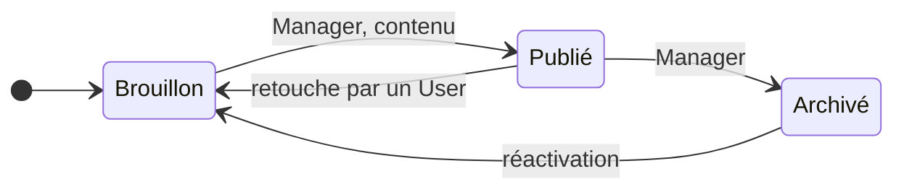

# 📚 Gestion des connaissances

> Pratique ITIL 4 *Knowledge management*. Code : `backend/Modules/KnowledgeManagement`,
> `frontend/src/modules/knowledge-management`. Préfixe des règles : **KB**. Socle commun et
> conventions (✅ / 🔜, lots) : [règles métier](../regles-metier.md).

[← Règles métier](../regles-metier.md) · [Toutes les pratiques](readme.md)

## 1. Objectif et périmètre

*Objectif ITIL 4 : maintenir et améliorer l'utilisation efficace, efficiente et pratique
de l'information et des connaissances dans toute l'organisation.*

Un **article** capitalise une solution, une procédure, une erreur connue ou une réponse
fréquente, pour qu'elle serve à nouveau (résolution d'incident plus rapide, exécution de
demande homogène). La pratique couvre la rédaction, la validation, la publication, la
revue périodique et le retrait. Hors périmètre : la documentation du projet S-Aloha
lui-même.

## 2. Rôles et droits

| Rôle ITIL | Rôle applicatif | Responsabilités |
|---|---|---|
| Rédacteur | User | Rédige et met à jour les brouillons |
| Responsable d'article | Responsable AD | Garant de l'exactitude, conduit les revues |
| Gestionnaire des connaissances | Manager | Valide et publie, archive |

| Action | User | Manager | Admin | Statut |
|---|---|---|---|---|
| Créer, modifier un brouillon | ✔ | ✔ | ✔ | ✅ |
| Publier | ✘ | ✔ | ✔ | ✅ |
| Retoucher un article publié | ✔ (repasse en Brouillon) | ✔ (reste publié) | ✔ | ✅ |
| Soumettre son brouillon à publication | ✔ | — | — | ✅ KB-21 |
| Confirmer à la revue, demander l'archivage | Responsable | ✔ | ✔ | ✅ KB-17 |
| Archiver, réactiver | ✘ | ✔ | ✔ | ✅ KB-18 |
| Supprimer | ✘ | ✘ | ✔ | ✅ |

## 3. Données

Champs communs (référence `KB-AAAA-NNNN`, titre, résumé = description, statut,
responsable AD, créateur, dates) : [socle](../regles-metier.md#5-règles-communes-aux-processus).

| Champ | Type | Oblig. | Valeurs / règle | Statut |
|---|---|---|---|---|
| `ArticleType` | texte 20 | ✔ | Solution, Procédure, Erreur connue, FAQ | ✅ |
| `Content` | texte | à la publication | Contenu en Markdown, rendu sans HTML brut (KB-10) | ✅ |
| `Keywords` | texte 300 | | Mots-clés, séparés par des virgules | ✅ |
| `ReviewDate` | date | | Prochaine revue ; publication + 12 mois si vide (KB-11) | ✅ |
| `PublishedBy`, `PublishedAt` | texte, date | auto | Publication (SOC-08) | ✅ |
| `SubmittedAt`, `SubmittedBy` | date, texte | auto | Brouillon soumis à publication, effacé à la publication ou à l'archivage (KB-21) | ✅ |
| `LastReviewedAt`, `LastReviewedBy` | date, texte | auto | Dernière revue confirmée (KB-17) | ✅ |
| `ArchiveRequestedAt`, `ArchiveRequestedBy`, `ArchiveRequestReason` | date, texte, texte 500 | à la demande | Archivage demandé à la revue, soldé par la décision du gestionnaire (KB-17) | ✅ |
| `HelpfulCount`, `NotHelpfulCount` | entier | auto | Retours des lecteurs sur la version publiée, remis à zéro à chaque publication | ✅ KB-13 |
| `Version` | entier | auto | Incrémentée à chaque publication | ✅ KB-15 |
| Versions (`KnowledgeArticleVersions`) | liste | auto | Version, titre, résumé, type, contenu, rédacteurs, publication ; supprimées avec l'article | ✅ KB-15 |
| Votes (`KnowledgeFeedbacks`) | liste | auto | Un vote par lecteur et par article (utile ou non), modifiable | ✅ KB-13 |

## 4. Cycle de vie

| De → Vers | Qui | Conditions (400 sinon) | Effets | Statut |
|---|---|---|---|---|
| — → Brouillon | Tous | Titre, type | Référence | ✅ |
| Brouillon → Publié | Manager | Contenu renseigné | `PublishedAt`, `PublishedBy` ; `ReviewDate` par défaut (KB-11) ; soumission soldée ; version + 1, conservée (KB-15) ; quatre yeux (KB-16) | ✅ |
| Publié → Brouillon | Auto | Retouche du titre, résumé, contenu ou type par un User | Publication effacée | ✅ |
| Publié → Archivé | Manager | | Demande d'archivage soldée ; retiré des suggestions et de la recherche par défaut | ✅ KB-18 |
| Archivé → Brouillon | Manager | | | ✅ KB-18 |
| Brouillon → Archivé | Manager | Abandon d'un brouillon | | ✅ KB-18 |

## 5. Règles de gestion

| ID | Règle | Statut | Lot |
|---|---|---|---|
| KB-01 | Types d'article : Solution, Procédure, Erreur connue, FAQ ; résumé, contenu, mots-clés, date de revue | ✅ | |
| KB-02 | **Publié** : gestionnaire uniquement, contenu obligatoire ; horodate `PublishedAt` / `PublishedBy`, effacés au retour en Brouillon | ✅ | |
| KB-03 | **Retoucher un article publié** (titre, résumé, contenu ou type) le ramène en **Brouillon** ; la retouche par un gestionnaire vaut publication ; mots-clés, date de revue et responsable se modifient librement | ✅ | |
| KB-04 | La **recherche** du registre porte sur le titre, la référence, les mots-clés et le contenu, sans tenir compte de la casse ; le registre ne renvoie pas le contenu (SOC-13). En tête du registre, le bloc « **Chercher d'abord** » interroge la **recherche hybride** (mots et sens) sur les articles publiés, problèmes établis et incidents résolus ([RAG-05](../recherche.md)) | ✅ | |
| KB-05 | **Revue échue** : un article Publié dont la date de revue est passée remonte dans « Relances » des gestionnaires | ✅ | |
| KB-10 | Le contenu est rendu en **Markdown** (titres, listes, code, citations, gras, italique, liens http(s) et mailto), sans interpréter de HTML brut ; onglet **Lecture** de la fiche | ✅ | |
| KB-11 | À la publication, une date de revue vide est fixée à **publication + 12 mois** | ✅ | |
| KB-12 | **Article d'erreur connue** créé depuis un problème (PRB-30) : type *Erreur connue*, titre, symptômes (description du problème) et contournement repris, relié au problème ; quand le problème est Clos *Corrigé*, l'article est proposé à l'archivage (Relances des gestionnaires) | ✅ | |
| KB-13 | **Retour des lecteurs** : « utile / pas utile » sur un article publié, un vote par utilisateur ; 3 « pas utile » de plus que d'« utile » le signalent en relance à son responsable | ✅ (vote modifiable ; signalé : notification au responsable au franchissement du seuil, console du responsable, Mon travail, et des gestionnaires, Relances ; une nouvelle publication repart sans votes) | 3 |
| KB-14 | **Utilisation** : nombre d'incidents et de demandes reliés à l'article (INC-19), affiché sur la fiche | ✅ | |
| KB-15 | **Versions** : chaque publication conserve la version précédente (contenu, auteur, date), consultable sur la fiche | ✅ (chaque publication est gardée : numéro, contenu, rédacteurs, publieur, date ; la retouche d'un article publié par un gestionnaire le republie en nouvelle version ; encadré « Versions publiées » de la fiche) | 3 |
| KB-16 | **Quatre yeux** : un gestionnaire ne publie pas un article dont il est le seul rédacteur, sauf Admin | ✅ (rédacteurs : le créateur et quiconque a modifié le titre, le résumé, le type ou le contenu, d'après le journal d'audit ; 400 sinon) | 3 |
| KB-17 | **Revue** : à la date de revue, le responsable (en personne ou par son groupe AD) ou un gestionnaire confirme l'article (nouvelle date de revue, un an par défaut, sans repasser en Brouillon) ou demande son archivage, motivé ; la demande remonte dans « Décisions » des gestionnaires | ✅ | |
| KB-18 | **Archiver** et réactiver : gestionnaire uniquement ; transitions selon le § 4 (SOC-05) | ✅ | |

## 6. Délais, calculs et alertes

| ID | Règle | Statut | Lot |
|---|---|---|---|
| KB-20 | Notifications (SOC-21) : brouillon soumis à publication → gestionnaires ; publication → rédacteur ; revue échue → responsable | ✅ | |
| KB-21 | **Soumettre à publication** : un User marque son brouillon « prêt » (contenu exigé) ; il remonte dans « Décisions » des gestionnaires | ✅ | |

## 7. Liens avec les autres pratiques

| Lien | Sens | Règle | Statut |
|---|---|---|---|
| Problème → Article | Erreur connue | KB-12, PRB-30 | ✅ |
| Incident → Article | Solution utilisée (lien, compté par KB-14) ; suggestion | INC-19, KB-14 | ✅ (lien, utilisation) / 🔜 (suggestion) |
| Demande → Article | Procédure d'exécution | Lien manuel | ✅ |
| Changement → Article | Procédure de mise en œuvre | Lien manuel | ✅ |

## 8. Console et indicateurs

Console ✅ : articles à revoir et articles d'erreur connue à archiver (Relances,
gestionnaires, KB-12) ; brouillons soumis à publication et archivages demandés (Décisions,
KB-21, KB-17) ; articles jugés peu utiles (Relances des gestionnaires, Mon travail du
responsable, KB-13) ; mes articles (Mon travail).

| Indicateur | Calcul | Statut |
|---|---|---|
| Volumétrie par statut et par type | | ✅ (statut) / 🔜 |
| Articles les plus utilisés | KB-14, top 10 | 🔜 KB-30 (lot 2) |
| Part des articles à jour | Publiés dont la revue n'est pas échue | 🔜 KB-31 (lot 2) |
| Incidents résolus avec un article | Incidents résolus reliés à un article / incidents résolus | 🔜 KB-32 (lot 2) |

## 9. API

| Route | Policy | Rôle |
|---|---|---|
| `GET /api/knowledge` (filtres `status`, `q`, `owner`), `GET /api/knowledge/{id}` | User | Registre (sans contenu), fiche |
| `POST /api/knowledge`, `PUT /api/knowledge/{id}` | User (Publié : Manager) | Rédaction, transitions |
| `DELETE /api/knowledge/{id}` | Admin | Suppression |
| `POST /api/knowledge/{id}/submit` | User | Soumettre un brouillon à publication (KB-21) |
| `POST /api/knowledge/{id}/review` (`{ nextReviewDate }`), `POST /api/knowledge/{id}/archive-request` (`{ reason }`) | Responsable de l'article, Manager | Revue confirmée, archivage demandé (KB-17) |
| `GET /api/knowledge/{id}/usage` | User | Incidents et demandes reliés (KB-14) |
| `GET /api/knowledge/suggest?text=` | User | Suggestions pour un incident — 🔜 INC-19 |
| `GET/POST /api/knowledge/{id}/feedback` (`helpful`) | User | Mon vote ; retour utile / pas utile sur un article publié (KB-13) |
| `GET /api/knowledge/{id}/versions` | User | Versions publiées (KB-15) |

## 10. Scénarios d'acceptation

- **KB-02** — *Étant donné* un brouillon sans contenu, *quand* un Manager le publie, *alors* 400 ; un User qui publie, 403.
- **KB-03** — *Étant donné* un article Publié, *quand* un User modifie son contenu, *alors* il repasse Brouillon, `PublishedAt` vide ; s'il ne modifie que les mots-clés, il reste Publié.
- **KB-10** — *Étant donné* un contenu « `# Étapes` » et « `<script>` », *alors* la fiche affiche un titre et le texte `<script>` échappé.
- **KB-11** — *Quand* un Manager publie un article sans date de revue le 7 octobre 2026, *alors* sa date de revue est le 7 octobre 2027.
- **KB-17** — *Étant donné* un article Publié dont Fara est responsable, *quand* Fara confirme l'article sans date, *alors* il reste Publié et sa revue passe à dans un an ; un autre User, 403.
- **KB-18** — *Quand* un User archive un article, *alors* 403 ; un Manager, l'article passe Archivé.
- **KB-21** — *Quand* un User soumet un brouillon avec contenu, *alors* il apparaît dans « Décisions » des gestionnaires jusqu'à sa publication.
- **KB-12** — *Étant donné* un problème passé Erreur connue, *quand* on accepte la proposition, *alors* un brouillon *Erreur connue* reprend le contournement et est relié au problème.
